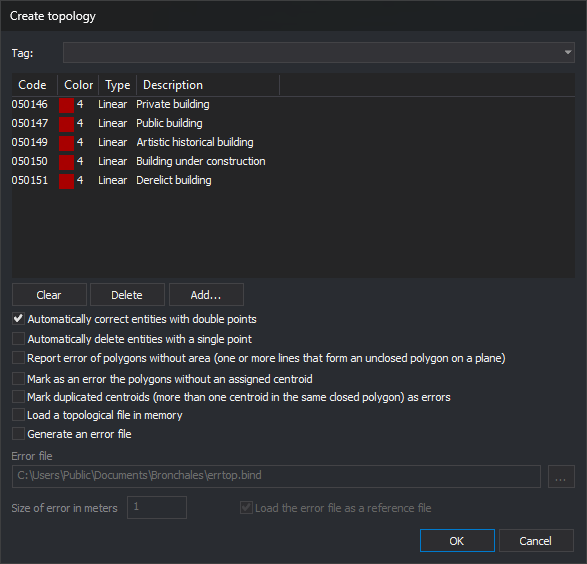

# BINTOP
<!-- id: bintop -->
<!-- origen: 54d1bce69dae062f704029ce9d556a9ae63b2612 -->

Build the enclosure topology of the active drawing file: join lines with the selected codes into arcs, form enclosures from those arcs, and associate each enclosure with the text bearing one of those codes inside it (its centroid). Report errors in the Tasks pane and optionally save them to an error file. The topology is stored in memory, not on disk, for other commands to use.

## Parameters

Without parameters, the command displays a dialog box (see [Dialog box](#dialog-box)). With parameters, it runs without a dialog box (see [Running with parameters](#running-with-parameters)).

## Notes

### Entities used

The command uses entities in the active drawing file that are not deleted, are within the area of interest, and are visible (not hidden and with at least one visible code). Only entities with at least one selected code are used:

* **Lines**: each line is an arc. Its endpoints are nodes.
* **Texts**: each text is a candidate centroid. The command uses its insertion point.
* **Points**: these are an error ("Entities with a single point").

Polygon entities do not form arcs.

Before forming enclosures, the command checks for two serious errors:

* lines whose first two or last two vertices coincide in X and Y (duplicate points at the start or end);
* lines with fewer than two vertices and points bearing any of the codes.

If it finds either error, the command does not form enclosures: it displays the "Double points found" or "Entities with a single point have been located" balloon and adds a task for each entity.

### Enclosures and centroids

The command traverses the nodes of the arcs to form rings:

* **Enclosure**: a ring with positive area and no repeated vertices.
* **Island**: a ring with negative area (the exterior boundary of a group of connected enclosures). The command uses it as a hole in the enclosure containing it.
* **Polygon without area**: a ring that passes through the same vertex twice or has only two distinct vertices, such as a dangling line traversed along both sides.

Each enclosure receives the centroid whose insertion point lies inside it. An enclosure with centroid text `*` becomes a hole. With `#nombre` (see below), hole text and centroid prefixes are defined by that topology in the code table.

### Dialog box

The upper section is the code selection dialog box:

* The drop-down lists code table tags with the `#` prefix. Selecting one replaces the list with the codes bearing that tag.
* **Clear** empties the list.
* **Delete** removes the selected code.
* **Add...** adds codes from the table.

The list cannot be empty: clicking **OK** without any codes displays a message and leaves the dialog box open.

| Option | Description | Default |
| :--- | :--- | :--- |
| Automatically correct entities with double points | Before forming the topology, remove all consecutive vertices repeated in X and Y from every line in the active file, regardless of code, whose first two or last two vertices coincide in X and Y. The command deletes the line and adds the corrected one. The Results pane shows the number corrected | Selected |
| Automatically delete entities with a single point | Before forming the topology, delete points in the active file bearing any selected code. Does not delete lines with a single vertex | Selected |
| Report error of polygons without area (one or more lines that form an unclosed polygon on a plane) | Add a task for each polygon without area and, if generating an error file, save its boundary with code `NOAREA` | Selected |
| Mark as an error the polygons without an assigned centroid | Selected: add a task for each enclosure without a centroid and save its boundary in the error file. Cleared: these enclosures are invalid, and the command adds a "Line that should be part of polygon" task for each line bearing the selected codes that belongs to no valid enclosure | Selected |
| Mark duplicated centroids (more than one centroid in the same closed polygon) as errors | Add a task for each enclosure with multiple centroids and for each group of centroids outside any enclosure. Add an `ERRCEN` marker to the error file at each text acting as a duplicate centroid | Selected |
| Load a topological file in memory | Add the topology to the loaded topologies. If cleared, the command only reports errors | Selected |
| Generate an error file | Enable the next three fields | Selected |
| Error file | Full file path. The **...** button opens the save dialog box with formats supporting writing. The dialog box always opens with `errtop.bind` in the active file folder | `<carpeta>\errtop.bind` |
| Size of error in meters | Half the side length of error markers, in the file coordinate units: meters for a projected system, degrees for a geographic system | 1 |
| Load the error file as a reference file | Load the error file as a reference file when finished | Selected |

Clicking **OK** with **Generate an error file** selected performs these checks:

* the size is a number greater than 0, written with a decimal point;
* the file has a full path and its folder exists;
* the file is not already loaded as a drawing or reference file.

If any check fails, the dialog box displays a message, moves the cursor to the field, and remains open.

Options other than the error file name are saved under registry key `HKEY_CURRENT_USER\Software\Digi21\Digi3D.NET\DigiNG\Extensiones\DigiNG.OrdenesStandard\DigiNG.OrdenesTopologia\Bintop`, in values `CorregirPuntosDobles`, `EliminarArcosUnSoloPunto`, `PoligonosSinArea`, `PoligonosSinCentroide`, `CentroidesDuplicados`, `CargarEnMemoria`, `GenerarFicheroErrores`, `TamanoErrores`, and `CargarFicheroErrores`. The code list starts empty each time.

From the dialog box, the command works in 2D and only with the active file, even when [CREATE\_TOPOLOGIES\_REFERENCE\_FILES](/digi3d-ai/referencia/ventana-de-dibujo/variables/c/crear-topologias-archivos-referencia.md) is enabled. The topology takes the active file name with extension `.top`: for `D:\Modelos\Bronchales\modelo.bind`, its name is `D:\Modelos\Bronchales\modelo.top`. This is a name, not a file: the command writes nothing to disk except the error file.

### Results

If the `LimpiarAutomaticamente` configuration key is enabled, the command first empties the Tasks pane. The Results pane shows:

* `Topology: <nombre>`;
* the number of arcs, enclosures (`Polygons`), and islands;
* depending on the checkboxes, polygons without area, polygons without centroids, duplicate centroids, and centroids without polygons;
* with the checkbox for missing centroids cleared, lines that should form a polygon but do not.

If no lines bear the codes, the command writes "No entities to be worked with have been found" and the number of centroids.

Each error is a task in the Tasks pane, grouped under the topology name. Double-click a task to move the view to the error:

* duplicate points and entities with a single point: to the error coordinate;
* polygons without area, enclosures without centroids, and lines that should form polygons: to a temporary copy of the boundary;
* duplicate centroids and centroids outside polygons: to the texts, with a subtask for each text.

### Error file

If the file exists, the command deletes it and recreates it in the format corresponding to its extension. It contains:

* **`ERRCEN`**: a marker for each entity with duplicate points (at the repeated vertex), entity with a single point, duplicate centroid, and centroid outside an enclosure (at its insertion point). The marker is a closed line running from the error point to a corner, around the square of side 2 × size centered on the point, and back to the point.
* **`NOAREA`**: the boundary of each polygon without area.
* the boundary of each enclosure without a centroid, without an error code.

Lines that should form a polygon are not saved in the file. To review the file loaded as a reference, use [ERR+](/digi3d-ai/referencia/ventana-de-dibujo/ordenes/e/err-mas.md), which traverses entities in the first loaded reference file.

### Loaded topology

If a topology with the same name already exists for the same file, the command replaces it. The topology reflects the file when the command runs: after editing lines or texts, run the command again. Related commands:

* [SEE\_TOPOLOGIES](/digi3d-ai/referencia/ventana-de-dibujo/ordenes/v/ver-topologias.md) shows or hides loaded topologies.
* [LEAVE\_TOP](/digi3d-ai/referencia/ventana-de-dibujo/ordenes/d/dejar-top.md) unloads a topology.
* [DELETE\_ENCLOSURE](/digi3d-ai/referencia/ventana-de-dibujo/ordenes/b/borra-r.md) and other enclosure commands require at least one loaded topology.

### Running with parameters

`BINTOP=[tabla] [polígonos_sin_área] [polígonos_sin_centroide] [topología_3D] [centroides_duplicados] [generar_archivo_errores] [nombre_fichero_de_errores tamaño_de_error cargar_como_referencia] [cargar_en_memoria]`

| Parameter | Description |
| :--- | :--- |
| tabla | Text file with one code per line; the command reads the first word of each line. If it cannot open the file, it writes the error in the Results pane and ends. The topology is named `<carpeta del archivo de dibujo>\<nombre de la tabla sin extensión>.top` |
| polígonos_sin_área | 1 to report polygons without area, 0 otherwise |
| polígonos_sin_centroide | Same as the dialog box checkbox |
| topología_3D | 1 to compare Z as well when joining arc endpoints, 0 to compare them in 2D. Duplicate points are always checked in 2D |
| centroides_duplicados | 1 to report duplicate centroids and those outside any enclosure |
| generar_archivo_errores | 1 to generate the error file. If so, three parameters follow: |
| nombre_fichero_de_errores | If no folder is specified, create it in the drawing file folder. If it does not end in `bin`, the command appends `.bin` |
| tamaño_de_error | Half the side length of markers, in coordinate units |
| cargar_como_referencia | 1 to load the error file as a reference file |
| cargar_en_memoria | 1 to load the topology into memory |

All parameters are required. If any is missing, the command sounds the error tone, displays "Missing parameters", and ends. If no export format exists for the error file, the command ends without forming the topology. With parameters, the command neither corrects duplicate points nor deletes points.

`BINTOP=#nombre` uses topology `nombre` from the code table:

* use its codes, option for polygons without centroids, 3D option, hole text, and centroid prefixes;
* report polygons without area and duplicate centroids, generate no error file, and load the topology into memory as `nombre`;
* if the table does not define that topology, use all visible entities.

The **Topology/Create topologies** submenu options run `BINTOP=#nombre`: **Create all topologies** runs the command for each topology in the table without emptying the Tasks pane between runs, and each remaining option runs it for its topology.

If [CREATE\_TOPOLOGIES\_REFERENCE\_FILES](/digi3d-ai/referencia/ventana-de-dibujo/variables/c/crear-topologias-archivos-referencia.md) is enabled, running the command with parameters forms a topology for each loaded drawing file, with the same name and error file.

Examples:

* `bintop="c:\tabla1.tab" 1 0 0 0 0 1`: form the topology with codes from `c:\tabla1.tab` in 2D, report polygons without area, do not report polygons without centroids or duplicate centroids, generate no error file, and load the topology into memory.
* `bintop="c:\tabla1.tab" 1 1 0 1 1 "c:\err.bin" 2 1 1`: as above, but report all errors, save them in `c:\err.bin` with size 2 markers, load that file as a reference, and load the topology into memory.

If quality control rejects a corrected line, the original line is retained and is not counted as corrected.

## Command characteristics

| Command type | [Interactive command](/digi3d-ai/referencia/ventana-de-dibujo/ordenes-interactivas.md) without parameters; immediate command with parameters |
| :--- | :--- |
| Repeats automatically | No |
| Menu option | Topology/Create topologies/Create all topologies Topology/Create topologies/(one option per tag) |
| Toolbar | _This command has no associated toolbar button_ |
| Extension | DigiNG.OrdenesTopologia.dll |
| Implementation | Native |
| Related variables | [CREATE\_TOPOLOGIES\_REFERENCE\_FILES](/digi3d-ai/referencia/ventana-de-dibujo/variables/c/crear-topologias-archivos-referencia.md) |
| Related commands | [BINTRAM](/digi3d-ai/referencia/ventana-de-dibujo/ordenes/b/bintram.md) [DELETE\_ENCLOSURE](/digi3d-ai/referencia/ventana-de-dibujo/ordenes/b/borra-r.md) [SEARCH\_CENTROID](/digi3d-ai/referencia/ventana-de-dibujo/ordenes/b/buscar-centroide.md) [CREATE\_TOPOLOGIES\_VISIBLE\_CODES](/digi3d-ai/referencia/ventana-de-dibujo/ordenes/c/crear-topologias-codigos-visibles.md) [LEAVE\_TOP](/digi3d-ai/referencia/ventana-de-dibujo/ordenes/d/dejar-top.md) [ERR+](/digi3d-ai/referencia/ventana-de-dibujo/ordenes/e/err-mas.md) [EXPORT\_TOPOLOGY](/digi3d-ai/referencia/ventana-de-dibujo/ordenes/e/exportar-topologia.md) [TOPOLOGY\_FROM\_POLYGON](/digi3d-ai/referencia/ventana-de-dibujo/ordenes/t/topologia-a-poligono.md) [SEE\_TOPOLOGIES](/digi3d-ai/referencia/ventana-de-dibujo/ordenes/v/ver-topologias.md) |
| Internal name | {4FB24176-ED2B-4626-BB9B-1A80C76D2F7D} |
