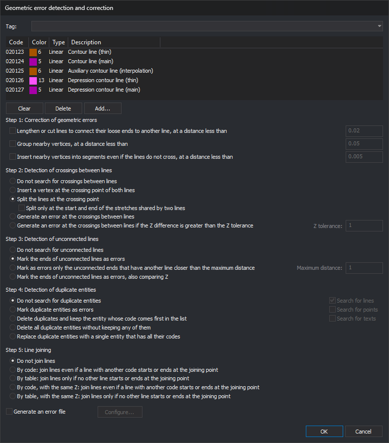
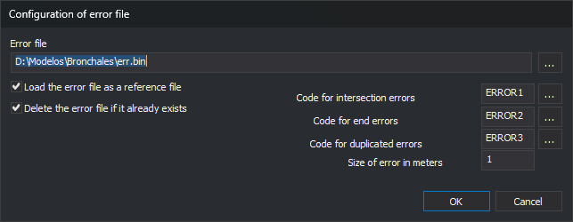

# BINTRAM
<!-- id: bintram -->
<!-- origen: ab0bf8741a7eda1bd2a9548138ec7d306f27fd7c -->

Correct and detect geometric errors in entities bearing specified codes: extend or trim dangling ends, group and insert vertices, process line crossings, detect unconnected endpoints and duplicate entities, and join lines.

## Parameters

Without parameters, the command displays a dialog box. With parameters, it runs without a dialog box; see [Running with parameters](#running-with-parameters).

## Notes

### Dialog box

The command requests codes and options in _Geometric error detection and correction_. The upper section is [Select codes](/digi3d-ai/referencia/cuadros-de-dialogo/selecciona-codigos.md): the drop-down lists code table tags, and choosing one replaces the list with codes bearing that tag. **Add...**, **Delete**, and **Clear** modify the list. Each run starts with an empty list.

Options for the five steps appear below the list. Enter tolerances and distances in meters; the command converts them to the drawing file reference system units. Enter Z tolerance in Z coordinate units.

Clicking **OK** performs these checks:

* the list contains at least one code;
* each tolerance for an enabled option is a number greater than 0, and Z tolerance is a number greater than or equal to 0;
* if **Generate an error file** is selected, that file is not loaded as a drawing file.

If a check fails, the dialog box displays a message, leaves the cursor in the field, and remains open. Fields of disabled options are not checked. Click **Cancel** to end without doing anything.

### Entities processed

The command works on the active drawing file and only processes entities that are not deleted, are visible, are within the area of interest, and have at least one enabled code from the list. Codes are compared by full name: wildcards are not supported. An entity with multiple codes is processed if any of them is listed and enabled.

Lines mentioned in each step always mean lines bearing these codes: lines with other codes do not participate.

### Step order

Steps run in this order, each using the previous step's result: the three options of step 1 (in displayed order), step 2, step 3, step 4, and step 5. For example, splitting lines in step 2 means step 3 no longer marks endpoints connected by that split as unconnected.

### Step 1: Correction of geometric errors

* **Lengthen or cut lines to connect their loose ends to another line, at a distance less than**: an endpoint is dangling if it does not coincide in X and Y with an endpoint of another line or the other endpoint of the same line. If another line lies within a square centered on the endpoint with side twice the tolerance, move the endpoint to its projection on that line: extend a line that falls short or trim one that overshoots. The endpoint retains its Z. Also delete lines with two vertices and at least one dangling endpoint whose plan length is less than the tolerance. Only lines are processed, not polygons.
* **Group nearby vertices, at a distance less than**: line vertices less than the tolerance apart in plan move to the group's mean position. Change X and Y of grouped vertices and retain their Z. Only lines are processed.
* **Insert nearby vertices into segments even if the lines do not cross, at a distance less than**: if a line vertex is less than the tolerance from a segment of another line, or another segment of the same line, and its projection falls inside that segment, insert a vertex into the segment at that vertex's position, with Z interpolated along the segment. Lines, polygons, and their holes are processed.

### Step 2: Detection of crossings between lines

Process lines, polygons, and their holes, including a line's self-intersections.

* **Do not search for crossings between lines**.
* **Insert a vertex at the crossing point of both lines**: add a vertex to each line at the crossing, with Z interpolated along each line's segment.
* **Split the lines at the crossing point**: split each line into several at the crossing points. Each section retains the original line's codes and attributes.
  * **Split only at the start and end of the stretches shared by two lines**: if two lines share a section, split them only at its start and end, not at every intermediate vertex. Enabled only with the splitting option.
* **Generate an error at the crossings between lines**: leave lines unchanged. Add an error task for each crossing line at each crossing.
* **Generate an error at the crossings between lines if the Z difference is greater than the Z tolerance**: as above, but only where the difference between the two lines' Z values, interpolated at the crossing, exceeds **Z tolerance**. The field is enabled only with this option.

### Step 3: Detection of unconnected lines

Only lines are processed. An endpoint is unconnected if it does not coincide with an endpoint of another line or the other endpoint of the same line. An endpoint touching another line in the middle of a segment or at an intermediate vertex counts as unconnected.

* **Do not search for unconnected lines**.
* **Mark the ends of unconnected lines as errors**: add an error task for each unconnected endpoint.
* **Mark as errors only the unconnected ends that have another line closer than the maximum distance**: add an error task for each endpoint with another line within a square centered on it with side twice **Maximum distance**. Use this to locate lines falling short of the line where they should end. Maximum distance is enabled only with this option.
* **Mark the ends of unconnected lines as errors, also comparing Z**: an endpoint is connected only if it coincides with another endpoint in X, Y, and Z.

### Step 4: Detection of duplicate entities

Two entities are duplicates if they have the same type, vertex count, and plan vertices, in the same or reverse order. Z and codes are not compared. For texts, only insertion points are compared, not content. **Search for lines**, **Search for points**, and **Search for texts** determine which types to search; polygons and other types are always searched. These checkboxes are enabled with every option except **Do not search for duplicate entities**.

* **Do not search for duplicate entities**.
* **Mark duplicate entities as errors**: add a _Duplicated entities_ task for each group, with a subtask for each entity.
* **Delete duplicates and keep the entity whose code comes first in the list**: retain the entity whose code is highest in the code list and delete the others in each group.
* **Delete all duplicate entities without keeping any of them**: delete every entity in each group.
* **Replace duplicate entities with a single entity that has all their codes**: delete the group and add a copy of the entity whose code is highest in the list, with all their codes. If the option allowing geometries with repeated codes is disabled, codes are not repeated.

### Step 5: Line joining

Only lines are processed. Join two lines if their endpoints coincide in X and Y and they have the same codes and database attributes. The resulting line retains the direction of the majority of joined sections.

* **Do not join lines**.
* **By code: join lines even if a line with another code starts or ends at the joining point**: join even if a line with another code starts or ends there. If three or more joinable lines start or end at the point, join none.
* **By table: join lines only if no other line starts or ends at the joining point**: join only if no other line starts or ends there.
* **By code, with the same Z: join lines even if a line with another code starts or ends at the joining point** and **By table, with the same Z: join lines only if no other line starts or ends at the joining point**: as above, but endpoints must also coincide in Z. With these two options, each line is joined at most once per execution: run the command again to join a chain of more than two lines.

With the first two joining options, the entire chain is joined in a single execution.

### Error file

If **Generate an error file** is selected, create an error symbol for each error added to the Tasks pane and save them in a separate drawing file. Only options marking errors create symbols: the last two in step 2, the three in step 3 that mark endpoints, and **Mark duplicate entities as errors**. If no errors are found, no file is created.

**Configure...**, enabled with the checkbox, opens _Configuration of error file_:

| Field | Description | Default value |
| :--- | :--- | :--- |
| Error file | File path. **...** opens a dialog box for choosing it and its format. Canceling retains the previous name. Cannot be empty | `err.bin` in the drawing file folder |
| Load the error file as a reference file | Load the error file as a drawing file when finished | Selected |
| Delete the error file if it already exists | Delete the file before writing symbols | Selected |
| Code for intersection errors | Code of step 2 symbols | `ERROR1` |
| Code for end errors | Code of step 3 symbols | `ERROR2` |
| Code for duplicated errors | Code of step 4 symbols | `ERROR3` |
| Size of error in meters | Symbol size. Must be greater than 0 | 1 |

The symbol for a crossing or endpoint is placed at that point. For a duplicate entity, it is placed at its vertex if it has only one, or midway between its two central vertices.

### Results

Running the command displays the [Results](/digi3d-ai/referencia/paneles/resultados.md) and [Tasks](/digi3d-ai/referencia/paneles/tareas.md) panes. If automatic clearing of the Tasks pane is enabled, the command empties it. A progress bar appears while entities are processed.

In Results, the command writes a message for each step executed and the number of affected entities: modified, newly created by splitting, deleted, grouped, or joined, and the number of crossing, endpoint, and duplicate errors.

Errors are added to the Tasks pane:

| Error | Description | Information |
| :--- | :--- | :--- |
| Crossing | Line intersection | An intersection between lines has been located |
| Unconnected endpoint | The line is not connected with another line at some of its ends | The line is not connected with another line at some of its ends |
| Duplicates | Duplicated entities, with a _Duplicated line_, _Duplicated point_, _Duplicated text_, or _Duplicated entity_ subtask for each entity | Duplicated entities |

Double-click a task to go to the error.

[UNDO](/digi3d-ai/referencia/ventana-de-dibujo/ordenes/u/undo.md) undoes all changes made to the drawing file in a single operation. It does not unload the error file.

### Remembered values

Clicking **OK** saves the five steps' options, tolerances, **Generate an error file**, and values from _Configuration of error file_ other than the file name under registry key `HKEY_CURRENT_USER\Software\Digi21\Digi3D.NET\DigiNG\Extensiones\DigiNG.OrdenesTopologia\Bintram`. The next run displays these values. The code list is not saved. The dialog box remembers its position and size.

### Running with parameters

`BINTRAM=[tabla o #etiqueta] [generar archivo de errores *1] [corregir *2] [agrupar *3] [insertar *4] [cruces *5] [extremos *6] [duplicadas *7] [unión *8]`

All parameters are required. If any is missing, the command sounds the error tone, displays _Missing parameters_, and ends without modifying the drawing. Distances are in meters, as in the dialog box. Values are neither checked nor saved.

* **tabla o #etiqueta**: one of these forms:
  * a quoted path to a text file containing codes. The command takes the first word of each line. If it cannot open the file, it writes the error in Results and ends;
  * `#` followed by a code table tag name, such as `#altimetria`. Use codes bearing that tag, in code table order; this order determines which entity is retained when `*7` is `2` or `4`. If no code bears the tag, write the error in Results and end.
* **\*1** `1` or `0`. With `1`, seven parameters follow: `[archivo de errores] [eliminar si existe 1/0] [tamaño del error] [código de cruces] [código de extremos] [código de duplicadas] [cargar como archivo de dibujo 1/0]`. Without a path, the file is created in the drawing file folder. If its name does not end in `bind`, append `.bind`.
* **\*2** `1` or `0`. With `1`, the extension or trimming tolerance follows.
* **\*3** `1` or `0`. With `1`, the vertex grouping tolerance follows.
* **\*4** `1` or `0`. With `1`, the vertex insertion tolerance follows.
* **\*5** `0` do not search, `1` insert vertex, `2` split, `3` generate error, `4` generate error by Z, followed by Z tolerance. Splitting only at the start and end cannot be specified: the command splits at every crossing.
* **\*6** `0` do not search, `1` mark all, `2` mark using a maximum distance, followed by that distance, `3` mark comparing Z.
* **\*7** `0` do not search, `1` mark, `2` delete retaining the highest-priority entity, `3` delete all, `4` replace with one bearing all codes. With `1` or `2`, `[buscar líneas] [buscar puntos] [buscar textos]` follow, each `1` or `0`; with `3` or `4`, search all three types.
* **\*8** `0` do not join, `1` by code, `2` by table, `3` by code with the same Z, `4` by table with the same Z.

Example:

`BINTRAM="C:\ASTE.tab" 1 "C:\err.bind" 1 2 cod1 cod2 cod3 1 1 0.3 0 0 4 0.2 2 0.5 1 1 1 1 1`

Use codes from `C:\ASTE.tab`; generate `C:\err.bind`, deleting it if it exists, with 2 m symbols bearing codes `cod1`, `cod2`, and `cod3`, and load it when finished; extend or trim with 0.3 m tolerance; do not group or insert vertices; mark crossings with Z differences greater than 0.2; mark dangling endpoints with another line less than 0.5 m away; mark duplicate lines, points, and texts, and join lines by code.

`BINTRAM=#altimetria 0 0 0 0 2 0 0 1`

Use codes bearing tag `altimetria`; generate no error file; do not extend, group, or insert vertices; split lines at crossings; do not search for unconnected endpoints or duplicates, and join lines by code.

While entering parameters in the command line, the help above it highlights the current parameter in bold and explains its accepted values below. Parameters depending on a previous value, such as the seven error file parameters, appear when that value is entered.

Each step is applied entirely or not at all: if Digi3D.AI rejects any new entities from a step, that step leaves the drawing file unchanged and retains the original entities. Other steps proceed normally. If quality control rejects the grouped entity when grouping duplicates, that group's duplicate entities are retained.

## Command characteristics

| Command type | [Interactive command](/digi3d-ai/referencia/ventana-de-dibujo/ordenes-interactivas.md) without parameters; immediate command with parameters |
| :--- | :--- |
| Repeats automatically | No |
| Menu option | _This command has no associated menu option_ |
| Toolbar | _This command has no associated toolbar button_ |
| Extension | DigiNG.OrdenesTopologia.dll |
| Implementation | Native |
| Related variables | No related variables |
| Related commands | [DETECT\_LINE\_CROSSING](/digi3d-ai/referencia/ventana-de-dibujo/ordenes/d/detectar-cruce-lineas.md) [ERR](/digi3d-ai/referencia/ventana-de-dibujo/ordenes/e/err.md) [ERR-](/digi3d-ai/referencia/ventana-de-dibujo/ordenes/e/err-menos.md) [ERR+](/digi3d-ai/referencia/ventana-de-dibujo/ordenes/e/err-mas.md) [UNDO](/digi3d-ai/referencia/ventana-de-dibujo/ordenes/u/undo.md) |
| Internal name | {20673463-9D22-4d74-AA28-5A60AECCA0E5} |
