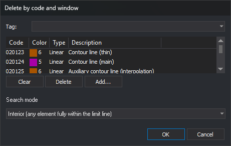

# DELETE\_COD\_W
<!-- id: borra-cod-v -->
<!-- origen: 4147bc8b117449c448e9b4eab71ea63fffb29e52 -->

Delete entities with any specified code that lie inside, overlap, or cross a line serving as a boundary (window).

## Parameters

Does not accept parameters.

## Notes

The command displays "Select the line that acts as a border." The line must exist in the drawing before you run the command. Only lines can be selected: a polygon cannot serve as the boundary. If the selected entity is not a line, an error tone sounds, and the command continues waiting for a line.

After selecting the line, the command displays "Calculating..." and the [Select codes](/digi3d-ai/referencia/cuadros-de-dialogo/selecciona-codigos.md) dialog box with its own **Search mode** field below the code list:

Each time you run the command, the code list is empty, and the search mode is **Interior**. Click **Cancel** to end without action.

| Search mode | Drop-down text | Description |
| :--- | :--- | :--- |
| Interior | Interior (any element fully within the limit line) | Delete lines with all vertices inside the window or on its boundary, and polygons and complex entities completely inside the window |
| Cut | Cut (cuts the elements on the limit line) | Clip lines crossing the boundary: delete interior portions and retain exterior portions. Delete lines entirely inside the window. Polygons and complex entities are neither deleted nor clipped |
| Overlap | Overlap (any element with at least one point within the limit line) | Delete lines with at least one vertex inside the window or on its boundary, and polygons and complex entities overlapping the window |

Points, point-based complex entities, and texts are deleted in all three modes if their first vertex lies inside the window or on its boundary.

The command only searches for and deletes entities in the active drawing file. It excludes deleted entities, those outside the area of interest, the boundary line itself, and entities with all codes disabled \([OFF](/digi3d-ai/referencia/ventana-de-dibujo/ordenes/o/off.md)\).

An entity is deleted whole if it has any chosen code, even if it has other codes too. If there are no entities to delete, an error tone sounds.

In Cut mode, if quality control rejects any retained portions, the command preserves all lines it was going to clip without clipping and adds no portions. Entities to be deleted whole are still deleted.

## Command characteristics

| Command type | [Interactive command](/digi3d-ai/referencia/ordenes/ordenes-interactivas.md) |
| :--- | :--- |
| Repeats automatically | No |
| Menu option | Edit/More/Cut based on polygon and code... |
| Toolbar | Delete and recover |
| Extension | DigiNG.OrdenesStandard.dll |
| Implementation | Native |
| Related variables | No related variables |
| Related commands | [DELETE\_COD](/digi3d-ai/referencia/ventana-de-dibujo/ordenes/b/borra-cod.md) [DELETE\_W](/digi3d-ai/referencia/ventana-de-dibujo/ordenes/b/borra-v.md) |
| Internal name | {89AC83BA-9BC7-4c4d-8E5C-5384E892EB0F} |
