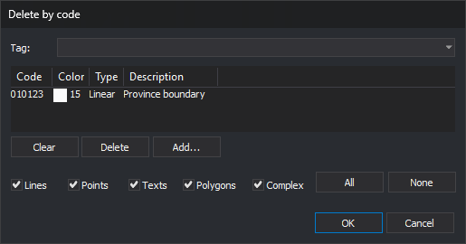

# DELETE\_COD
<!-- id: borra-cod -->
<!-- origen: 01654a5a569aa999e1db9da22ab9cf57605b64b0 -->

Delete entities with the specified code and geometry types.

## Parameters

| Parameter number | Description | Optional |
| :--- | :--- | :--- |
| 1 … N | "Code type" pairs. Use `#etiqueta` as the code to specify all codes assigned that tag. The type is a string of [geometry type](/digi3d-ai/referencia/ventana-de-dibujo/tipos-de-geometria.md) letters | Yes |

In this command, `P` includes points, point-based complex entities, oriented points, and multipoints; `B` indicates images; and `*` includes all geometry types.

With at least two parameters, the command deletes without displaying the dialog box and beeps when finished. If the number of parameters is odd, it ignores the last one. Without parameters, or with only one, it displays the dialog box.

### Notes

The command only acts on undeleted, visible entities within the area of interest in the active drawing file.

Codes support `*` and `?` wildcards.

This command also allows secondary codes to be deleted. If the entity only has the specified code, the entity is deleted. If it has other codes, the command replaces the original entity with a copy without the specified code.

The command displays a progress bar while iterating over the drawing file.

### Dialog box

Choose codes in the [Select codes](/digi3d-ai/referencia/cuadros-de-dialogo/selecciona-codigos.md) dialog box. Below the code list are **Lines**, **Points**, **Texts**, **Polygons**, and **Complex** checkboxes, with **All** and **None** buttons to select or clear all five. Selected types apply to all chosen codes.

* **Points** also includes point-based complex entities, oriented points, and multipoints.
* With all five checkboxes selected, the command deletes entities of all geometry types, including images.
* With no checkboxes selected, the command deletes nothing.

Each time you run the command, the dialog box opens with an empty code list and all five checkboxes selected. It does not remember the previous selection.

If Digi3D.AI rejects the copy without the specified code of an entity with multiple codes, the original entity is preserved. Other entities are processed normally.

## Command characteristics

| Command type                                    | [Immediate command](/digi3d-ai/referencia/ordenes/ordenes-no-interactivas.md)                                              |
| ------------------------------------------------ | ---------------------------------------------------------------------------- |
| Repeats automatically                           | No                                                                           |
| Menu option           | Edit/Delete entities based on code...                                      |
| Toolbar | [Delete and recover](/digi3d-ai/referencia/barras-de-herramientas/eliminar-y-recuperar.md) |
| Extension                                        | DigiNG.OrdenesStandard.dll                                                   |
| Implementation | Native |
| Related variables                           | No related variables                                              |
| Related commands                             | [DELETE\_COD\_W](/digi3d-ai/referencia/ventana-de-dibujo/ordenes/b/borra-cod-v.md) [DELETE\_E](/digi3d-ai/referencia/ventana-de-dibujo/ordenes/b/borra-e.md) [RECOVER\_COD](/digi3d-ai/referencia/ventana-de-dibujo/ordenes/r/recupera-cod.md) |
| Internal name | {5ED4CD51-E4DB-4365-8522-F82BBC7813A2} |
