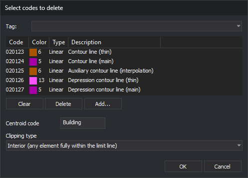

# DELETE\_ENCLOSURE
<!-- id: borra-r -->
<!-- origen: 90afa38da4c9a27e5e6087eae0364654a1f5f01b -->

Delete entities in the active drawing file that have any selected code and lie inside enclosures of loaded topologies whose centroids have a specified code. Lines crossing an enclosure boundary can be clipped to it.

## Parameters

Does not accept parameters.

## Notes

This command is similar to [DELETE\_W](/digi3d-ai/referencia/ventana-de-dibujo/ordenes/b/borra-v.md) and has the same clipping types. It differs in three ways: its windows are topology enclosures whose centroids have the specified code, rather than a closed line; it only deletes entities with any code in the list; and it cannot delete the exterior.

The command works with topologies loaded using [BINTOP](/digi3d-ai/referencia/ventana-de-dibujo/ordenes/b/bintop.md). If none are loaded, it sounds an error tone, displays _There is no topology file loaded_, and ends.

### Dialog box

Running the command displays the _Select codes to delete_ dialog box:

| Field | Description | Default value |
| :--- | :--- | :--- |
| Code list | Codes of entities to delete. Supports wildcards (`*`, `?`) | _Empty_ |
| Centroid code | Only enclosures whose centroids have this code are processed. Supports wildcards | _Empty_ |
| Clipping type | Which entities are considered inside the enclosure. See [Clipping types](#clipping-types) | Interior |

_OK_ is only enabled when the list contains at least one code and _Centroid code_ is not empty. Clicking _OK_ saves the centroid code and clipping type in the `Codigo` and `TipoRecorte` values under the registry key `HKEY_CURRENT_USER\Software\Digi21\Digi3D.NET\DigiNG\Extensiones\DigiNG.OrdenesTopologia\BorraR`. The next time you run the command, the dialog box displays these values. Click _Cancel_ to end the command without changes.

### Entities processed

The command only processes entities in the active drawing file that:

* Have any code in the list.
* Are visible and within the area of interest.
* Are neither arcs nor centroids of any loaded topology. You can therefore use `*` or arc codes without deleting the enclosure boundary or its neighbors' boundaries.

An entity with multiple codes is deleted whole if any code is in the list. Lines with the topology's code that do not belong to any enclosure, such as a dangling line, are not topology arcs and are processed.

### Enclosures and holes

The command iterates over enclosures in all loaded topologies and processes those with a centroid having the specified code. An enclosure is clipped using its exterior boundary and its hole boundaries: what lies inside an island is outside the enclosure. If the island is itself an enclosure whose centroid has the specified code, the command processes it as another enclosure. An entity lying exactly on the boundary is considered inside.

### Clipping types

| Type | Lines | Polygons and complex entities | Points and texts |
| :--- | :--- | :--- | :--- |
| Interior | Delete lines with all vertices inside. Lines crossing the boundary are unchanged | Delete those completely inside | Delete if the insertion point is inside |
| Cut | Clip lines crossing the boundary: delete inside portions and retain outside portions. Delete lines completely inside | Unchanged | Delete if the insertion point is inside |
| Overlap | Delete the entire line if at least one vertex is inside | Delete any with at least one vertex inside | Delete if the insertion point is inside |

_Interior_ and _Overlap_ decide by vertices: a line with all vertices inside the enclosure counts as interior even if one of its segments crosses an island.

In _Cut_ mode, outside portions retain the original line's codes and attributes and are used for subsequent enclosures: a line crossing two processed enclosures loses the portions in both.

### End of the command

When finished, the command refreshes the view, sounds the end-of-command tone, and displays a message with the number of processed enclosures, deleted entities, and clipped lines. If no enclosure has a centroid with the specified code, it sounds an error tone, displays _No enclosure of the loaded topologies has a centroid with the code_ followed by the code, and changes nothing.

The command does not unload the topology: arcs and centroids are unchanged.

[UNDO](/digi3d-ai/referencia/ventana-de-dibujo/ordenes/u/undo.md) undoes all deletions and added portions at once.

If Digi3D.AI rejects any new portions of lines clipped by an enclosure, those lines are preserved without clipping, and no portions are added. Other enclosures are processed normally.

## Command characteristics

| Command type | Immediate command |
| :--- | :--- |
| Repeats automatically | No |
| Menu option | _This command has no associated menu option_ |
| Toolbar | _This command has no associated toolbar button_ |
| Extension | DigiNG.OrdenesTopologia.dll |
| Implementation | Native |
| Related variables | No related variables |
| Related commands | [BINTOP](/digi3d-ai/referencia/ventana-de-dibujo/ordenes/b/bintop.md) [DELETE\_COD\_E](/digi3d-ai/referencia/ventana-de-dibujo/ordenes/b/borra-cod-r.md) [DELETE\_W](/digi3d-ai/referencia/ventana-de-dibujo/ordenes/b/borra-v.md) [CHNG\_COD\_E](/digi3d-ai/referencia/ventana-de-dibujo/ordenes/c/camb-cod-r.md) [RENAMCOD\_E](/digi3d-ai/referencia/ventana-de-dibujo/ordenes/r/renomcod-r.md) [UNDO](/digi3d-ai/referencia/ventana-de-dibujo/ordenes/u/undo.md) |
| Internal name | {A5DDA5DD-4A6A-422F-88CA-386ED660D395} |
