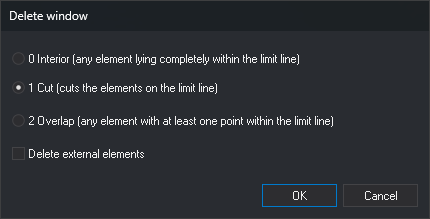

# DELETE\_W
<!-- id: borra-v -->
<!-- origen: d22ccf5eab411c671163687af73927a907b94366 -->

Delete entities inside a closed line serving as a window, those overlapping it, or those outside it. In **Cut** mode, clip lines at the window boundary.

## Parameters

| Parameter number | Description | Values | Optional |
| :--- | :--- | :--- | :--- |
| 1 | Code of lines serving as windows | Code | Yes |
| 2 | Clipping type | 0 = Interior, 1 = Cut, 2 = Overlap | Yes |
| 3 | Delete external elements | 0 = no, 1 = yes | Yes |

Supply all three parameters or none. With fewer than three, the command ignores them and operates interactively.

With all three parameters, the command skips the dialog box and requests no selection. It displays "Calculating..." and uses, one after another, each line in the active file or visible reference files meeting all these conditions as a window: it has the specified code, is closed, has at least 4 vertices, is undeleted, is visible, and is within the area of interest. Windows do not delete or clip each other. The command ends when finished.

If the clipping type is not 0, 1, or 2, an error tone sounds, the "Wrong clipping type" balloon appears, and the command ends without changing the drawing.

## Notes

Without parameters, the command displays the **Delete window** dialog box:

Each time you run the command, the dialog box opens with **1 Cut** selected and **Delete external elements** cleared. Click **Cancel** to end the command without action.

Clicking **OK** displays "Select the line that acts as a border." The line must exist before you run the command, be closed, and have at least 4 vertices. If the selected entity is not a line or fails these conditions, an error tone sounds, and the command continues waiting for another selection. Selecting a valid line performs the deletion and ends the command.

With **Delete external elements** cleared, the command deletes the window interior:

| Clipping type | Dialog box text | What is deleted |
| :--- | :--- | :--- |
| 0 | Interior (any element lying completely within the limit line) | Lines with all vertices inside the window or on its boundary, and polygons and complex entities completely inside |
| 1 | Cut (cuts the elements on the limit line) | Clip lines crossing the boundary: delete interior portions and retain exterior portions. Delete lines entirely inside the window. Polygons and complex entities are neither deleted nor clipped |
| 2 | Overlap (any element with at least one point within the limit line) | Lines with at least one vertex inside the window or on its boundary, and polygons and complex entities with any vertex inside |

With **Delete external elements** selected, the command deletes the window exterior:

| Clipping type | What is deleted |
| :--- | :--- |
| 0 | Lines with no vertices inside the window or on its boundary, and polygons and complex entities completely outside |
| 1 | Clip lines crossing the boundary: delete exterior portions and retain interior portions. Delete lines entirely outside the window. Polygons and complex entities are neither deleted nor clipped |
| 2 | Lines with at least one vertex outside the window, including those crossing the boundary, and polygons and complex entities with any vertex outside |

Points, point-based complex entities, and texts are classified in all three modes by their first vertex: inside the window or on its boundary, or outside. Multipoints and images are classified by their vertices: in Interior and Cut modes, they are deleted if all vertices lie in the deletion area; in Overlap mode, if any vertex lies there.

In Cut mode, each clipped line is deleted, and retained portions are added as new lines with the original's codes. A clipped closed line becomes open portions.

The command only deletes entities from the active drawing file. It excludes deleted entities, those outside the area of interest, the window itself, and entities with all codes disabled \([OFF](/digi3d-ai/referencia/ventana-de-dibujo/ordenes/o/off.md)\).

To use topology enclosures as windows and delete only entities with specific codes, use [DELETE\_ENCLOSURE](/digi3d-ai/referencia/ventana-de-dibujo/ordenes/b/borra-r.md).

Use [UNDO](/digi3d-ai/referencia/ventana-de-dibujo/ordenes/u/undo.md) to undo the command's deletions and additions.

### Example

`DELETE_W=LIMITE 1 0`

Use each closed line with code `LIMITE` as a window. Clip lines crossing its boundary, delete interior portions and interior entities, and retain the `LIMITE` lines.

In Cut mode, if Digi3D.AI rejects any retained portions, the command clips none of the lines crossing the boundary, preserving them whole. Other deletions are applied normally.

## Command characteristics

| Command type | [Interactive command](/digi3d-ai/referencia/ordenes/ordenes-interactivas.md) without parameters; immediate command with parameters |
| :--- | :--- |
| Repeats automatically | No |
| Menu option | Edit/Delete window |
| Toolbar | Delete and recover |
| Extension | DigiNG.OrdenesStandard.dll |
| Implementation | Native |
| Related variables | No related variables |
| Related commands | [DELETE\_COD\_W](/digi3d-ai/referencia/ventana-de-dibujo/ordenes/b/borra-cod-v.md) [DELETE\_E](/digi3d-ai/referencia/ventana-de-dibujo/ordenes/b/borra-e.md) [DELETE\_ENCLOSURE](/digi3d-ai/referencia/ventana-de-dibujo/ordenes/b/borra-r.md) |
| Internal name | {290F947C-CAAD-4945-8524-9E71C9713108} |
