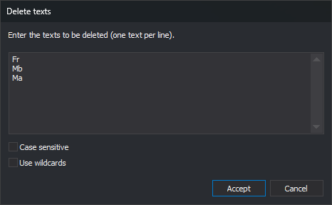

# DELETE\_TEXT
<!-- id: borrar-texto -->
<!-- origen: f4cd5c562919a2f3aaae93377dd61252f46de6f1 -->

Delete text entities in the active drawing file whose content matches any of the specified texts.

## Parameters

| Parameter number | Description | Optional |
| :--- | :--- | :--- |
| 1 … N | Text to delete. Supports the `*` and `?` wildcards. Enclose text containing spaces in double or single quotes | Yes |

## Notes

The command visits text entities in the active drawing file. It ignores other loaded drawing files and the area of interest, and also deletes matching text that is not visible.

A text entity is deleted if its **entire** content matches any specified text. To delete text containing `PK` anywhere, enter `*PK*`.

Two wildcards are supported:

* `*` matches any sequence of characters, including an empty sequence.
* `?` matches exactly one character.

With wildcards enabled, you cannot search for a literal `*` or `?`.

### With parameters

Each parameter is a text to delete. Separate parameters with spaces, tabs, or `=`; commas do not separate parameters. Enclose text containing spaces in quotes: `DELETE_TEXT "POINT KILOMETRICO"`.

No dialog appears. Comparison uses wildcards and is case-sensitive. A beep sounds when finished, even if no text was deleted.

### Without parameters

The **Delete texts** dialog appears:

In **Enter the texts to be deleted (one text per line).**, enter one text per line. Each line is a complete text, even if it contains spaces, commas, or quotes. Leading and trailing spaces and tabs are removed, and blank lines are ignored.

* **Case sensitive**: when checked, `Rio` does not match `RIO`. When unchecked, they match, including accented letters and ñ (`camión` matches `CAMIÓN`).
* **Use wildcards**: when checked, `*` and `?` act as wildcards. When unchecked, they are compared as ordinary characters.

The dialog always opens empty with both boxes unchecked; it does not remember the previous values. **Cancel** closes it without deleting anything.

### Undo and read-only files

[UNDO](/digi3d-ai/referencia/ventana-de-dibujo/ordenes/u/undo.md) restores all text deleted by one run in a single operation.

If the active drawing file is read-only, no text is deleted, the error sound plays, and **You are attempting to save an entity in a read-only file** appears.

## Command characteristics

| Command type | Immediate command |
| :--- | :--- |
| Repeats automatically | No |
| Menu option | _This command has no associated menu option_ |
| Toolbar | _This command has no associated toolbar button_ |
| Extension | DigiNG.OrdenesStandard.dll |
| Implementation | Native |
| Related variables | No related variables |
| Related commands | [CHNG\_TEXT](/digi3d-ai/referencia/ventana-de-dibujo/ordenes/c/camb-texto.md) [REPLACE\_TEXT](/digi3d-ai/referencia/ventana-de-dibujo/ordenes/r/reemplazar-texto.md) |
| Internal name | {7AAC4699-1AB0-415D-88BA-2B3846F3AEC9} |
