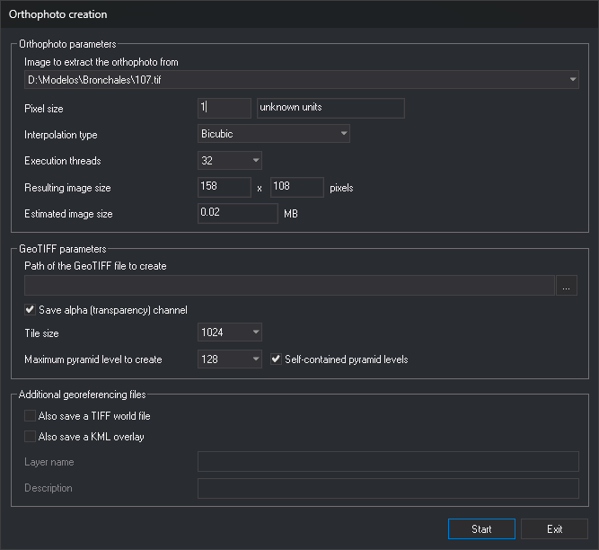

# CAL\_ORTHO
<!-- id: cal-orto -->
<!-- origen: 2b64e7193ea5c14b01b147a16bb0c34c4e42c022 -->

Compute orthophotographs.

## Parameters

| Parameter number | Description | Optional |
| :--- | :--- | :--- |
| 1 | Interpolation type: 0 nearest neighbor, 1 bilinear, 2 bicubic | Yes |
| 2 | Output TIFF (Tag Image File Format) filename | Yes |
| 3 | Code of the line delimiting the orthophoto | Yes |
| 4 | Store transparency: 0 to omit it, 1 to store it. Defaults to 1 | Yes |

Supply the first three parameters together. Without them, the command asks you to select the orthophoto boundary line and opens a dialog with computation options.

## Creation of Orthophotos dialog

**Orthophoto parameters**

* **Image from which to extract the orthophoto**: stereo model image to project.
* **Pixel size**: in drawing reference system units, shown to the right.
* **Interpolation type**: nearest neighbor, bilinear, or bicubic.
* **Execution threads**: number of threads computing the orthophoto in parallel.
* **Size of the obtained image** and **Estimated weight of the image**: calculated from the selected line and pixel size.

**GeoTIFF parameters**

* **Path to the GeoTIFF file to be created**: click **...** to choose the path.
* **Save alpha channel (of transparency)**: add a transparency channel to the TIFF.
* **Tile size**: size of TIFF tiles in pixels.
* **Maximum pyramidal level to be created** and **Self-contained pyramidal levels**: reduced-resolution levels stored inside the TIFF. **Self-contained pyramidal levels** is enabled when the maximum level is not 0.

**Additional geo-referencing files**

* **Save also a Tiff World File**: generate a `.tfw` file.
* **Save also a superposition in KML**: generate a KML file. This enables **Layer name** and **Description**.

## Notes

The command requires a loaded stereo model and at least one drawing file supporting projection (such as a digital terrain model) to obtain Z for each pixel.

With parameters, it finds the first line with the specified code and computes the orthophoto without requesting data. Pixel size is [AD](/digi3d-ai/referencia/ventana-de-dibujo/variables/d/da.md), in drawing reference system units. The left image is the source. A `.tfw` georeferencing file is generated alongside the TIFF. An error message appears if the interpolation type exceeds 2 or no line has the specified code (including when the drawing is empty).

If pixel size is not greater than 0, an error message appears and no orthophoto is computed.

## Command characteristics

| Command type | [Interactive command](/digi3d-ai/referencia/ordenes/ordenes-interactivas.md) without parameters; [Immediate command](/digi3d-ai/referencia/ordenes/ordenes-no-interactivas.md) with parameters |
| :--- | :--- |
| Repeats automatically | No |
| Menu option | Orthophoto/Create orthophoto... |
| Toolbar | _This command has no associated toolbar button_ |
| Extension | DigiNG.OrdenesRaster.dll |
| Implementation | Native |
| Related variables | [AD](/digi3d-ai/referencia/ventana-de-dibujo/variables/d/da.md) — active distance |
| Related commands | No related commands |
| Internal name | {47972709-ACC5-4F6E-8B04-DEB6F73554B0} |
