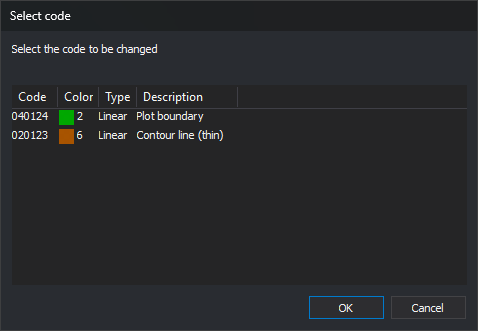

# CHNG\_COD
<!-- id: camb-cod -->
<!-- origen: aeda4533f358ceede6bf4f2b216e7da6cf4ace93 -->

Change the code assigned to a graphic entity.

## Parameters

This command takes no parameters.

## Notes

This command supports the "\*" and "?" wildcards. Before running it, set the new code as the active code with [COD+](/digi3d-ai/referencia/ventana-de-dibujo/ordenes/c/cod-mas.md).

If the first active code contains wildcards, the command combines it with the first code of the entity. It also combines these first codes when the entity has several codes and you choose to change a different code of that entity.

If the entity has only one code, the command assigns the active codes to it. If it has several codes, the **Select the code to be changed** dialog lets you choose which code to replace with the first active code.

Select the code in the list and click **OK**. **Cancel**, or **OK** with no code selected, leaves the entity unchanged.

The command changes entities only in the active drawing file. Selecting an entity from another loaded drawing file plays the error sound and leaves the entity unchanged.

Multiple selection is supported. With multiple selection, the command ignores entities from other loaded drawing files and displays the **Select the code to be changed** dialog once for each entity with several codes. When finished, the Results window shows the number of selected entities and the number of processed entities.

If quality control rejects the modified entity, the original entity remains unchanged.

## Command characteristics

| Command type | [Interactive command](/digi3d-ai/referencia/ordenes/ordenes-interactivas.md) |
| :--- | :--- |
| Repeats automatically | Yes |
| Menu option | Edit/Change entity codes for the active ones |
| Toolbar | Edit codes |
| Extension | DigiNG.OrdenesStandard.dll |
| Implementation | Native |
| Related variables | [REPEAT](/digi3d-ai/referencia/ventana-de-dibujo/variables/r/repite.md) — repeat the last command executed |
| Related commands | [ADD\_CODES](/digi3d-ai/referencia/ventana-de-dibujo/ordenes/a/anadir-codigos.md) [COD+](/digi3d-ai/referencia/ventana-de-dibujo/ordenes/c/cod-mas.md) [EDIT\_CODES](/digi3d-ai/referencia/ventana-de-dibujo/ordenes/e/editar-cod.md) [REPLACE\_COD](/digi3d-ai/referencia/ventana-de-dibujo/ordenes/s/sustituye-cod.md) |
| Internal name | {AFDBCF7C-FC23-4f74-8C13-3CFB8E8145B1} |
