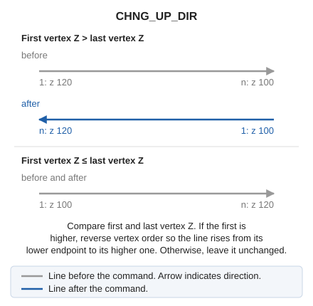

# CHNG\_UP\_DIR
<!-- id: camb-sen-sube -->
<!-- origen: a123f6940d7a5fd0f5d6d9f5f399654699aaa3c2 -->

Change the order of recorded points after digitizing a drawing element so the line runs from its lower endpoint to its higher endpoint.

## Parameters

| Parameter number | Description | Optional |
| :--- | :--- | :--- |
| 1 | Code or codes (one or more, separated by spaces) | Yes |

Without parameters, select one or more lines. With codes, process all visible lines bearing them and end:

`CHNG_UP_DIR=<código>`

## Notes

Compare only the first and last vertices' Z. If the first is higher, reverse all vertices; otherwise, leave the line unchanged. Intermediate vertices are not reordered individually.

If quality control rejects a modified entity, retain its original unchanged. Handle multiple entities independently: retain each rejected original and modify the others.

## Command characteristics

| Command type | [Interactive command](/digi3d-ai/referencia/ordenes/ordenes-interactivas.md) |
| :--- | :--- |
| Repeats automatically | Yes |
| Menu option | Edit/Polylines/Order Z coordinates in ascending order |
| Toolbar | Polyline direction |
| Extension | DigiNG.OrdenesStandard.dll |
| Implementation | Native |
| Related variables | [REPEAT](/digi3d-ai/referencia/ventana-de-dibujo/variables/r/repite.md) — repeat the last command executed |
| Related commands | [CHNG\_DIREC](/digi3d-ai/referencia/ventana-de-dibujo/ordenes/c/camb-sen.md) [CHNG\_DOWN\_DIR](/digi3d-ai/referencia/ventana-de-dibujo/ordenes/c/camb-sen-baja.md) |
| Internal name | {D83AFA04-4452-42a2-BF5E-B1A4F69DCA21} |
