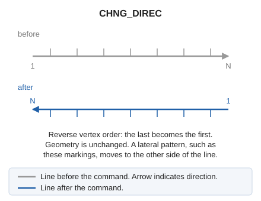

# CHNG\_DIREC
<!-- id: camb-sen -->
<!-- origen: e4c03ab13cf82c2c7dde0521a516c9507cd42b9b -->

Reverse the order of recorded points after digitizing a drawing element.

## Parameters

| Parameter number | Description | Optional |
| :--- | :--- | :--- |
| 1 | Code or codes (one or more, separated by spaces) | Yes |

Without parameters, select one or more lines. With codes, reverse all visible lines bearing them and end:

`CHNG_DIREC=<código>`

## Notes

For patterned lines, such as woodland boundary codes, reversing direction changes the side toward which the pattern points.

If quality control rejects a modified entity, retain its original unchanged. Handle multiple entities independently: retain each rejected original and modify the others.

## Command characteristics

| Command type | [Interactive command](/digi3d-ai/referencia/ordenes/ordenes-interactivas.md) |
| :--- | :--- |
| Repeats automatically | Yes |
| Menu option | Edit/Polylines/Change direction of a line |
| Toolbar | Polyline direction |
| Extension | DigiNG.OrdenesStandard.dll |
| Implementation | Native |
| Related variables | [REPEAT](/digi3d-ai/referencia/ventana-de-dibujo/variables/r/repite.md) — repeat the last command executed |
| Related commands | [CHNG\_DOWN\_DIR](/digi3d-ai/referencia/ventana-de-dibujo/ordenes/c/camb-sen-baja.md) [CHNG\_UP\_DIR](/digi3d-ai/referencia/ventana-de-dibujo/ordenes/c/camb-sen-sube.md) [DETECT\_INTERSECTION\_DIRECTION](/digi3d-ai/referencia/ventana-de-dibujo/ordenes/d/detectar-interseccion-sentido.md) |
| Internal name | {B3B49658-61EF-4884-82F7-AD8FE6A7512E} |
