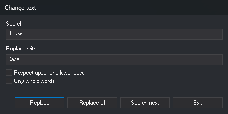

# CHNG\_TEXT
<!-- id: camb-texto -->
<!-- origen: a494a08de211c94372f5b709af2b2976977ce6f9 -->

Replace the content of text entities in the active drawing file that match specified text.

## Parameters

| Parameter number | Description | Values | Optional |
| :--- | :--- | :--- | :--- |
| 1 | Text to replace | Text | Yes |
| 2 | New text | Text | Yes |

Supply both parameters together. If only one is supplied, it is ignored and the dialog opens. Enclose text containing spaces or `=` in double or single quotes. To delete matching text entities, use `""` as the new text.

## Notes

Only visible text entities in the active drawing file and inside the area of interest are processed.

### With parameters

The command replaces undeleted text entities whose entire content equals the search text, without requesting data. Comparison is case-sensitive. If the new text is `""`, matching text entities are deleted.

### Without parameters

The **Change text** dialog appears:

* **Search**: text to find. While empty, **Replace**, **Replace all**, and **Search next** are disabled.
* **Replace with**: replacement text.
* **Respect upper and lower case**: make the search case-sensitive.
* **Only whole words**: match only entities whose entire content equals **Search**. This does not split text into words. When unchecked, text containing **Search** matches.
* **Search next**: move the view to the center of the next matching text entity and select it. At the end of the file, "Finished searching the active drawing file. No entity matching the search was found." appears. Clicking again restarts from the beginning.
* **Replace**: replace the selected text if it still matches **Search** and the checkboxes, then find the next match. If nothing is selected, only search.
* **Replace all**: replace all matching text. If **Search next** has already found a text entity, replacement starts there and continues to the end of the file. If no text is replaced, "Finished searching the active drawing file. No entity matching the search was found." appears.
* **Exit**: close the dialog.

With **Only whole words** checked, replacement changes the entire text content. Otherwise, it changes only matching portions; for example, replacing `Río` with `Arroyo` changes `Río Tajo` to `Arroyo Tajo`. Text entities left empty are deleted.

Text created by a replacement is not replaced again until you change **Search**, **Replace with**, or either checkbox.

If [DELETED](/digi3d-ai/referencia/ventana-de-dibujo/variables/b/borrados.md) is enabled, the dialog also searches deleted text entities.

The dialog remembers both text fields and checkboxes for the next time it opens. Initially, **Respect upper and lower case** is unchecked and **Only whole words** is checked.

### Saving changes

Each replacement creates new text with the same attributes as the original and deletes the original. If quality control or an extension rejects the new text, the original is retained.

All replacements during one run form a single undo operation: undo restores all text changed since the dialog opened.

## Command characteristics

| Command type | [Interactive command](/digi3d-ai/referencia/ventana-de-dibujo/ordenes-interactivas.md) without parameters; immediate command with parameters |
| :--- | :--- |
| Repeats automatically | No |
| Menu option | _This command has no associated menu option_ |
| Toolbar | _This command has no associated toolbar button_ |
| Extension | DigiNG.OrdenesStandard.dll |
| Implementation | Native |
| Related variables | [DELETED](/digi3d-ai/referencia/ventana-de-dibujo/variables/b/borrados.md) — show deleted entities |
| Related commands | [DELETE\_TEXT](/digi3d-ai/referencia/ventana-de-dibujo/ordenes/b/borrar-texto.md) [CHNG\_CHARACTER](/digi3d-ai/referencia/ventana-de-dibujo/ordenes/c/camb-caracter.md) [EDIT\_TEXT](/digi3d-ai/referencia/ventana-de-dibujo/ordenes/e/editar-texto.md) [REPLACE\_TEXT](/digi3d-ai/referencia/ventana-de-dibujo/ordenes/r/reemplazar-texto.md) |
| Internal name | {62E042B4-F679-4a73-83E3-1B8C989C2DB8} |
