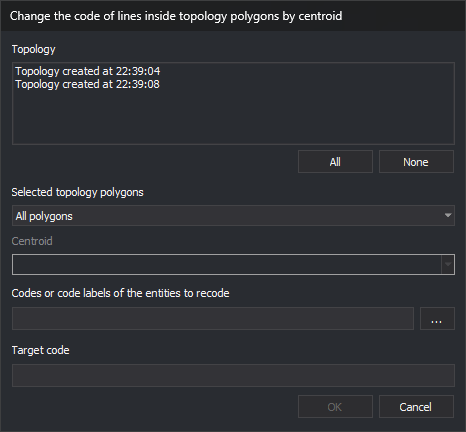

# CHANGE\_CODE\_LINES\_INSIDE\_TOPOLOGY\_POLYGONS
<!-- id: cambia-codigo-lineas-dentro-poligonos-topologia -->
<!-- origen: bc7655ad83bf5bfb538a71aeb52d64dc7dd446ca -->

Change codes of active drawing file entities inside polygons of one or more topologies. Lines crossing a polygon boundary are split there, and only interior portions change code.

## Parameters

| Parameter number | Description | Optional |
| :--- | :--- | :--- |
| 1 | Polygons to process: 0 all; 1 those with a centroid; 2 those with the centroid text in parameter 2. Nonnumeric values mean 0; any other value besides 0 and 2 means 1 | No |
| 2 | Centroid text. Supply only when parameter 1 is 2. Enclose text containing spaces in double quotes | Yes |
| 3 | Source code or codes. Supports wildcards and `#etiqueta`, meaning all code table codes with that tag. Enclose multiple space-separated codes in double quotes | No |
| 4 | Target code. Supports `?` and `*` wildcards | No |

If parameter 1 is not 2, omit parameter 2: source and target codes become parameters 2 and 3. With too few parameters \(fewer than three, or fewer than four when parameter 1 is 2\), all are ignored and the dialog opens. Parameter mode processes all loaded topologies.

## Notes

At least one topology must be loaded. Otherwise, **No topology loaded** appears and the command ends. The menu option is disabled while no topologies are loaded.

### Dialog

**Change code within topology polygons by centroid** contains:

| Control | Description |
| :--- | :--- |
| Topology | Loaded topologies, supporting multiple selection. Initially none checked |
| All / None | Check or uncheck all topologies |
| Selected topology polygons | **All polygons**, **Polygons that have any centroid**, or **Polygons that have a specific centroid** |
| Centroid | Enabled only for **Polygons that have a specific centroid**. Sorted, unique centroid texts from active drawing file polygons in checked topologies. Empty until a topology is checked. Changing checked topologies retains the selected text if still listed |
| Codes or code labels of the entities to recode | Space-separated source codes. Supports wildcards and `#etiqueta`. **...** opens code selection and appends chosen codes not already present |
| Target code | Code replacing each source code. Supports `?` and `*` |

**OK** is enabled when at least one topology is checked, both code fields contain a non-space character, and, for a specific centroid, a centroid is selected. Values are not saved; the dialog uses defaults each time. **Cancel** ends without changes.

### Operation

Only the active drawing file and topology polygons in it are processed. A topology not calculated for the active file is ignored.

1. Take undeleted active file entities with any source code, regardless of visibility or area of interest. Arcs and centroids of any loaded topology are always excluded, even with a source code.
2. Visit polygons of each topology meeting the chosen type. Specific centroid text comparisons are case-sensitive.
3. Process each polygon with its outer boundary and holes. Hole interiors are outside the polygon. A separate polygon inside a hole is processed independently.
4. For each polygon:
   * Split lines crossing its boundary, delete the original, and add the pieces. Interior pieces change code; exterior pieces retain the original code and may be split again by subsequent polygons.
   * A line without crossings is inside if the midpoint of its middle segment is inside or on the boundary. A line following the boundary therefore changes code unless it is a topology arc.
   * Points, text, and point complex entities change code if inside or on the boundary. Multipoints change if all vertices are inside or on it.
   * Polygons and complex entities are not processed.

Changing a code creates a copy with the new code and deletes the original.

### Code replacement

For each processed entity, replace every code matching a source code and retain other codes. Compose each new code from the replaced code and target:

* Ordinary target characters replace the character in the same position.
* `?` retains the original character at that position.
* `*` retains the remaining original code from that position.
* Without `*`, the new code has the target length.

For example, target `9??` changes `0123` to `912`; `9*` changes it to `9123`.

The target code is not checked against the code table. The replaced code loses its database attributes. New entities are added without quality checks, and vertices are not automatically inserted at intersections afterward.

### Result

The view is regenerated and a beep sounds. No message or modified entity count appears. Source codes matching no code \(for example, an empty tag\) cause no changes.

All changes form one [UNDO](/digi3d-ai/referencia/ventana-de-dibujo/ordenes/u/undo.md) operation.

If Digi3D.AI rejects any new piece of lines cut by a polygon, those lines remain whole and no pieces are added. Other polygons are still processed. A rejected recoded interior entity retains its original.

## Command characteristics

| Command type | Immediate command |
| :--- | :--- |
| Repeats automatically | No |
| Menu option | Topology/Change codes of lines passing inside topology polygons... |
| Toolbar | _This command has no associated toolbar button_ |
| Extension | DigiNG.OrdenesTopologia.dll |
| Implementation | Native |
| Related variables | No related variables |
| Related commands | [ADD\_CODES\_TOPOLOGY\_POLYGON\_BORDERS](/digi3d-ai/referencia/ventana-de-dibujo/ordenes/a/anadir-codigos-bordes-poligonos-topologia.md) [DELETE\_ENCLOSURE](/digi3d-ai/referencia/ventana-de-dibujo/ordenes/b/borra-r.md) [RENAMCOD\_E](/digi3d-ai/referencia/ventana-de-dibujo/ordenes/r/renomcod-r.md) [UNDO](/digi3d-ai/referencia/ventana-de-dibujo/ordenes/u/undo.md) |
| Internal name | {5319DE3E-3FDD-4C31-8CD4-7272778CACC5} |
