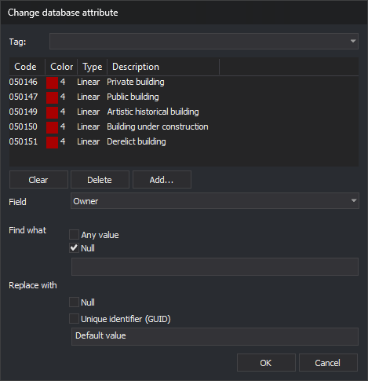

# CHANGE\_DDBB\_VALUES
<!-- id: cambiar-valores-bbdd -->
<!-- origen: d2e53acb1c45459c9582208de2e34bb0301735bb -->

Change values in the database associated with the drawing file.

## Parameters

Does not accept parameters.

## Change database attribute dialog box

The command requests codes and the change to make in this dialog box.

* **Code list**: codes of the entities to change. Manage them as in the [Select codes](../../../cuadros-de-dialogo/seleccione-codigos.md) dialog box: **Add...** adds codes, **Delete** removes the selected code, and **Clear** empties the list.
* **Field**: database field to change. The drop-down list only shows fields present in the tables of all codes in the list. **OK** is only enabled when a field is selected.
* **Find what**: value the field must have to be changed.
  * **Any value**: change the field regardless of its value.
  * **Null**: change only empty fields.
  * If neither is selected, change fields whose value equals the text in the box.
  * If both are selected, **Any value** takes precedence over **Null**.
* **Replace with**: new value.
  * **Null**: leave the field empty.
  * **Unique identifier (GUID)**: assign a new unique identifier (GUID), without braces, to each code matching the search. An entity with multiple matching codes receives a different GUID for each.
  * If neither is selected, assign the text in the box.
  * If both are selected, **Null** takes precedence over **Unique identifier (GUID)**.

## Notes

The command iterates over visible, undeleted entities within the area of interest in the active drawing file. For each code on those entities matching a selected code, it applies the change specified in the dialog box. Each change is saved to the database immediately.

If the database is open as read-only, the message "The database is open in read-only mode. The values were not changed." appears, and the command ends without changing anything.

If saving a value to the database fails, the command displays the error message. Depending on the error type, it stops processing the remaining entities or continues with the next. Changes saved before the error are retained.

## Command characteristics

| Command type | [Immediate command](/digi3d-ai/referencia/ordenes/ordenes-no-interactivas.md) |
| :--- | :--- |
| Repeats automatically | No |
| Menu option | Database/Change database values... |
| Toolbar | _This command has no associated toolbar button_ |
| Extension | DigiNG.OrdenesBaseDatos.dll |
| Implementation | Native |
| Related variables | No related variables |
| Related commands | [ASSIGN\_FIELD\_VALUE\_BBDD\_ENTITY](/digi3d-ai/referencia/ventana-de-dibujo/ordenes/a/asigna-atributo-bbdd-entidad.md) |
| Internal name | {3E045845-BD0D-45AB-8050-91448BF532A3} |
