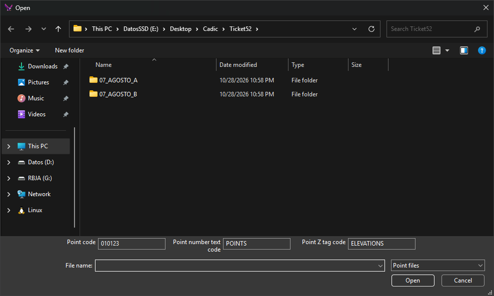

# LOAD\_P
<!-- id: carga-p -->
<!-- origen: 012368897fa8ad80139ee53c6c773087827e6894 -->

Read an ASCII coordinate file and add one point to the working file for each coordinate set \(X Y Z\) read.

## Parameters

| Parameter number | Description | Values | Optional |
| :--- | :--- | :--- | :--- |
| 1 | Coordinate filename, encoded in ASCII (American Standard Code for Information Interchange) | File path | Yes |

Without parameters, a dialog lets you select the file and the codes for the point, point number text, and elevation text:

* **Point code**: defaults to the first active code.
* **Point number text code**: defaults to `PUNTOS` (`POINTS` with the English interface).
* **Point Z tag code**: defaults to `COTAS` (`ELEVATIONS` with the English interface).

The dialog opens in the last used folder, with `.xyz` as the default extension.

## Notes

Each file line contains at least four values separated by spaces, tabs, commas, or `=`. Values after the fourth are ignored. Quoted text counts as a single value.

| Position | Description | Values |
| :--- | :--- | :--- |
| 1 | Point number. Used only as text | Text |
| 2 | X coordinate | Real number |
| 3 | Y coordinate | Real number |
| 4 | Z coordinate | Real number |

Coordinates use a period as the decimal separator and support signs and exponents. Lines with fewer than four values or nonnumeric coordinates are ignored.

Entities are added to the active drawing file.

For each line, the command creates:

* A point at the read coordinates, with the point code. If that code is linear, no point is created.
* Point number text offset by one text height ([TH](/digi3d-ai/referencia/ventana-de-dibujo/variables/a/at.md)) in both X and Y.
* Z text offset by one text height in X and two text heights downward in Y. Z uses the number of decimal places set by [NDEC](/digi3d-ai/referencia/ventana-de-dibujo/variables/n/ndec.md).

With the parameter, the point code is the first active code, the point number text code is `PUNTOS`, and the elevation text code is `COTAS`, regardless of interface language. Relative paths are resolved from the application working directory. If the file cannot be opened, "Error when opening file" appears.

## Command characteristics

| Command type | [Interactive command](/digi3d-ai/referencia/ordenes/ordenes-interactivas.md) without parameters; [Immediate command](/digi3d-ai/referencia/ordenes/ordenes-no-interactivas.md) with parameters |
| :--- | :--- |
| Repeats automatically | No |
| Menu option | _This command has no associated menu option_ |
| Toolbar | _This command has no associated toolbar button_ |
| Extension | DigiNG.OrdenesStandard.dll |
| Implementation | Native |
| Related variables | [AA](/digi3d-ai/referencia/ventana-de-dibujo/variables/a/aa.md) — active angle [TH](/digi3d-ai/referencia/ventana-de-dibujo/variables/a/at.md) — text height [JT](/digi3d-ai/referencia/ventana-de-dibujo/variables/j/jt.md) — text justification [NDEC](/digi3d-ai/referencia/ventana-de-dibujo/variables/n/ndec.md) — number of decimal places |
| Related commands | [LOAD\_T](/digi3d-ai/referencia/ventana-de-dibujo/ordenes/c/carga-t.md) |
| Internal name | {EF1460ED-3186-4c35-9815-1010C515C2EC} |
