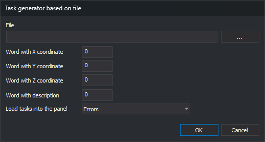

# LOAD\_TASKS\_FILE\_FORMAT
<!-- id: cargar-tareas-fichero-formato -->
<!-- origen: 7b95ce460d10ae094fe96ee5b1448b279340a771 -->

Read a text file containing point coordinates and create one task per line in the [Tasks](/digi3d-ai/referencia/paneles/tareas.md) pane.

## Parameters

Does not accept parameters.

## Notes

The command displays the **Task generator based on file** dialog box:

| Item | Description | Values |
| :--- | :--- | :--- |
| File | Text file path. The **...** button opens a dialog box to choose it. | File path |
| Word with X coordinate | Position of the word containing the X coordinate | Integer greater than or equal to 0; the first word is 0 |
| Word with Y coordinate | Position of the word containing the Y coordinate | Integer greater than or equal to 0 |
| Word with Z coordinate | Position of the word containing the Z coordinate | Integer greater than or equal to 0 |
| Word with description | Position of the word displayed as the task description | Integer greater than or equal to 0 |
| Load tasks into the panel as | Type of tasks created | **Messages**, **Warnings**, or **Errors**. Default: **Errors** |

Position fields only accept digits. The dialog box saves all values when you click **OK** and displays them the next time you run the command.

### File format

* Each line is split into words. Words are separated by spaces, tabs, commas, or `=`. Consecutive separators count as one.
* Text enclosed in double or single quotation marks is a single word, even if it contains spaces. Use this to write a description with multiple words: `100.5 200.25 35.0 "Poste roto"`.
* The coordinate decimal separator is a period.
* The command skips a line in these cases:
  * The line has fewer words than the highest position specified in the dialog box.
  * The X, Y, or Z word does not start with a number; for example, a header line.
* The file can be encoded as UTF-8, with or without a BOM, or as ANSI. UTF-16 is not supported.

### Created tasks

Each valid line creates a task in the Tasks pane:

* The **Description** column displays the word specified in **Word with description**.
* The **File** column displays the text file path.
* The **Unit** column displays `DigiNG.OrdenesStandard`.

A red triangle is drawn in the drawing window at each task's coordinates. Double-click a task to move the drawing window to its coordinates.

If [Empty automatically](/digi3d-ai/referencia/cuadros-de-dialogo/configuracion/panel-de-tareas/vaciar-automaticamente.md) is enabled, the command removes tasks from the pane before adding new ones. If [Group tasks by coordinates](/digi3d-ai/referencia/cuadros-de-dialogo/configuracion/panel-de-tareas/agrupar-tareas-por-coordenadas.md) is enabled, tasks with the same X and Y coordinates are grouped.

### Errors

* If the file cannot be opened, the command displays **Error when opening file** and does not modify the pane.
* If any position is negative, the command sounds an error tone and ends without reading the file.

## Command characteristics

| Command type | [Interactive command](/digi3d-ai/referencia/ventana-de-dibujo/ordenes-interactivas.md) |
| :--- | :--- |
| Repeats automatically | No |
| Menu option | Window/Tasks/Load tasks file (ascii) |
| Toolbar | _This command has no associated toolbar button_ |
| Extension | DigiNG.OrdenesStandard.dll |
| Implementation | Native |
| Related variables | No related variables |
| Related commands | [DELETE\_TASKS](/digi3d-ai/referencia/ventana-de-dibujo/ordenes/b/borrar-tareas.md) [LOAD\_TASKS](/digi3d-ai/referencia/ventana-de-dibujo/ordenes/c/cargar-tareas.md) [SAVE\_TASKS](/digi3d-ai/referencia/ventana-de-dibujo/ordenes/g/guardar-tareas.md) [TAREA+](/digi3d-ai/referencia/ventana-de-dibujo/ordenes/t/tarea-mas.md) [TAREA-](/digi3d-ai/referencia/ventana-de-dibujo/ordenes/t/tarea-menos.md) |
| Internal name | {6E345000-A069-4a06-94BF-5E7D0ACBB0D1} |
