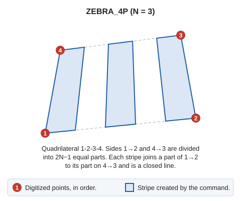

# ZEBRA\_4P
<!-- id: cebra-4p -->
<!-- origen: 7123d01c5bc669c1c7c757996c60a201fcd131da -->

Draw a crosswalk using the number of white stripes and 4 points defining its shape and position.

## Parameters

Does not accept parameters.

## Command characteristics

| Command type | [Interactive command](/digi3d-ai/referencia/ordenes/ordenes-interactivas.md) |
| :--- | :--- |
| Repeats automatically | No |
| Menu option | Draw/More/Zebra crossing with 4 points |
| Toolbar | Horizontal marking |
| Extension | DigiNG.OrdenesStandard.dll |
| Implementation | Native |
| Related variables | [REPEAT](/digi3d-ai/referencia/ventana-de-dibujo/variables/r/repite.md) — repeat the last command executed |
| Related commands | [ZEBRA](/digi3d-ai/referencia/ventana-de-dibujo/ordenes/c/cebra.md) |
| Internal name | {26B97B1C-8C5D-4b21-A6F3-C07C12AAE4EA} |
