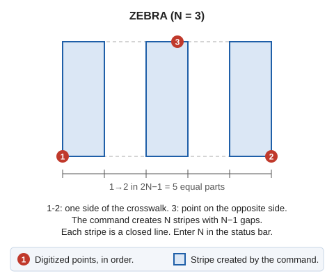

# ZEBRA
<!-- id: cebra -->
<!-- origen: 24dbd20235c99fa92ede838274bc37152b752935 -->

Draw crosswalks.

## Parameters

Does not accept parameters.

## Notes

Enter the number of white stripes and 3 points defining the crosswalk's shape and position.

## Command characteristics

| Command type | [Interactive command](/digi3d-ai/referencia/ordenes/ordenes-interactivas.md) |
| :--- | :--- |
| Repeats automatically | No |
| Menu option | Draw/More/Zebra crossing with 3 points |
| Toolbar | Horizontal marking |
| Extension | DigiNG.OrdenesStandard.dll |
| Implementation | Native |
| Related variables | [REPEAT](/digi3d-ai/referencia/ventana-de-dibujo/variables/r/repite.md) — repeat the last command executed |
| Related commands | [ZEBRA\_4P](/digi3d-ai/referencia/ventana-de-dibujo/ordenes/c/cebra-4p.md) |
| Internal name | {E805C5AC-338A-4943-8F5D-6BAA7BD6A591} |
