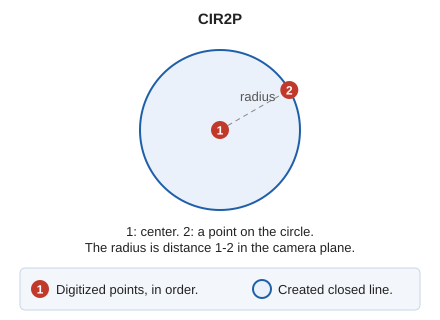

# CIR2P
<!-- id: cir2p -->
<!-- origen: 6b9d9d4f21e1b117f968ccd3f579cbd5b071ac15 -->

Draw a circle using its center and a point on it.

## Parameters

| Parameter number | Description | Values | Optional |
| :--- | :--- | :--- | :--- |
| 1 | Circle center | X, Y, and Z coordinates | Yes |
| 2 | Point in the working space | Circle radius | Yes |

## Command characteristics

| Command type | [Interactive command](/digi3d-ai/referencia/ordenes/ordenes-interactivas.md) |
| :--- | :--- |
| Repeats automatically | No |
| Menu option | Draw/More/Circumference with 2 points |
| Toolbar | Circumferences |
| Extension | DigiNG.OrdenesStandard.dll |
| Implementation | Native |
| Related variables | [REPEAT](/digi3d-ai/referencia/ventana-de-dibujo/variables/r/repite.md) — repeat the last command executed |
| Related commands | [CIR3D](/digi3d-ai/referencia/ventana-de-dibujo/ordenes/c/cir3d.md) [CIR3P](/digi3d-ai/referencia/ventana-de-dibujo/ordenes/c/cir3p.md) [CIRCR](/digi3d-ai/referencia/ventana-de-dibujo/ordenes/c/circr.md) |
| Internal name | {C9CE4CF2-6029-48e7-9FC1-141708C22393} |
