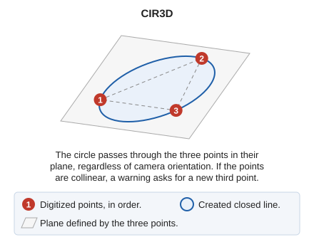

# CIR3D
<!-- id: cir3d -->
<!-- origen: 839ee867d11cb11f7fbe96b735259ec84cf7441e -->

Draw the circle through three given points in the plane they define.

## Parameters

| Parameter number | Description | Values | Optional |
| :--- | :--- | :--- | :--- |
| 1 | Point in the working space | X, Y, and Z coordinates | Yes |
| 2 | Point in the working space | XYZ coordinates | Yes |
| 3 | Point in the working space | XYZ coordinates | Yes |

## Notes

The difference from [CIR3P](cir3p.md) is the plane in which the circle is constructed:

* **CIR3P** works in the camera plane. The circle passes through the three points projected onto that plane, and all circle vertices are at the same depth. Use this command to work in plan view.
* **CIR3D** works in the plane defined by the three points, regardless of camera orientation. The circle passes exactly through the three digitized points.

CIR3D supports free-camera sensors—point clouds and stereo orthophotos—where the camera can look in any direction: for example, to digitize a porthole in a ship's hull with the camera facing the hull. Digitizing the porthole with CIR3P and the camera facing the hull constructs the circle in the camera plane rather than on the hull surface.

If the three points are collinear, they do not define a plane: the command displays a warning and waits for another third point.

## Command characteristics

| Command type | [Interactive command](/digi3d-ai/referencia/ordenes/ordenes-interactivas.md) |
| :--- | :--- |
| Repeats automatically | No |
| Extension | DigiNG.OrdenesStandard.dll |
| Implementation | Native |
| Related variables | [REPEAT](/digi3d-ai/referencia/ventana-de-dibujo/variables/r/repite.md) — repeat the last command executed |
| Related commands | [CIR2P](/digi3d-ai/referencia/ventana-de-dibujo/ordenes/c/cir2p.md) [CIR3P](/digi3d-ai/referencia/ventana-de-dibujo/ordenes/c/cir3p.md) [CIRCR](/digi3d-ai/referencia/ventana-de-dibujo/ordenes/c/circr.md) |
| Internal name | {042900CE-F65B-48AF-91EA-BA55665D6572} |
