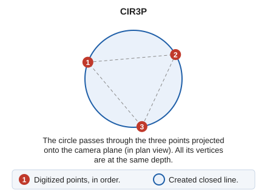

# CIR3P
<!-- id: cir3p -->
<!-- origen: f4d4d6142f7fb96c471e039f800118d7b2c8610f -->

Draw a circle using three given points.

## Parameters

| Parameter number | Description | Values | Optional |
| :--- | :--- | :--- | :--- |
| 1 | Point in the working space | X, Y, and Z coordinates | Yes |
| 2 | Point in the working space | XYZ coordinates | Yes |
| 3 | Point in the working space | XYZ coordinates | Yes |

## Notes

The triangle defined by the three points is inscribed in the circle.

The circle is constructed in the camera plane: all its vertices are at the same depth. To draw a circle passing exactly through three points outside the camera plane—with the free camera of point cloud and stereo orthophoto sensors—use [CIR3D](cir3d.md).

## Command characteristics

| Command type | [Interactive command](/digi3d-ai/referencia/ordenes/ordenes-interactivas.md) |
| :--- | :--- |
| Repeats automatically | No |
| Menu option | Draw/More/Circumference with 3 points |
| Toolbar | Circumferences |
| Extension | DigiNG.OrdenesStandard.dll |
| Implementation | Native |
| Related variables | [REPEAT](/digi3d-ai/referencia/ventana-de-dibujo/variables/r/repite.md) — repeat the last command executed |
| Related commands | [CIR2P](/digi3d-ai/referencia/ventana-de-dibujo/ordenes/c/cir2p.md) [CIR3D](/digi3d-ai/referencia/ventana-de-dibujo/ordenes/c/cir3d.md) [CIRCR](/digi3d-ai/referencia/ventana-de-dibujo/ordenes/c/circr.md) |
| Internal name | {6ED5F7BA-42D1-419c-982C-3088BDEFF125} |
