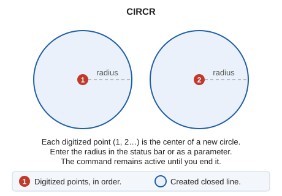

# CIRCR
<!-- id: circr -->
<!-- origen: 65f00b68cb25e113ac52b1901b2caa133259179f -->

Draw a circle by defining its center and entering its radius numerically.

## Parameters

| Parameter number | Description | Values | Optional |
| :--- | :--- | :--- | :--- |
| 1 | Circle radius, in coordinate reference system units | Number | Yes |

## Notes

The command displays a status bar field containing the radius, which you can change at any time. Each point you digitize is the center of a new circle with that radius; the command remains active until you end it.

## Command characteristics

| Command type | [Interactive command](/digi3d-ai/referencia/ordenes/ordenes-interactivas.md) |
| :--- | :--- |
| Repeats automatically | Yes |
| Menu option | Draw/More/Circumference with center and radius |
| Toolbar | Circumferences |
| Extension | DigiNG.OrdenesStandard.dll |
| Implementation | Native |
| Related variables | No related variables |
| Related commands | [CIR2P](/digi3d-ai/referencia/ventana-de-dibujo/ordenes/c/cir2p.md) [CIR3D](/digi3d-ai/referencia/ventana-de-dibujo/ordenes/c/cir3d.md) [CIR3P](/digi3d-ai/referencia/ventana-de-dibujo/ordenes/c/cir3p.md) |
| Internal name | {958A46FD-8051-4660-82A2-F5A14F314854} |
