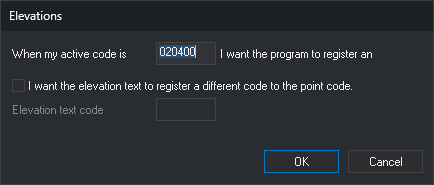

# COD\_HEIGHTS
<!-- id: cod-cotas -->
<!-- origen: 7ab53b44936f163e1e319fced9630910ce6f9ad4 -->

Specify the code with which the program automatically records spot elevations and, optionally, the elevation text code.

## Parameters

| Parameter number | Description | Values | Optional |
| :--- | :--- | :--- | :--- |
| 1 | Active code that causes the program to record a spot elevation when you press the data button. | A code such as 020401. Supports **\*** (any sequence of characters through the end) and **?** (any single character) wildcards, for example 0204\* | Yes. Without parameters, the command displays the **Elevations** dialog box |
| 2 | Elevation text code. | A code such as 020402 | Yes. If omitted, the text is recorded with the same code as the point |

Parameters after the second are ignored.

### Examples

`COD_HEIGHTS=020401`

`COD_HEIGHTS=020401 020402`

`COD_HEIGHTS=0204*`

## Notes

Without parameters, the command displays the **Elevations** dialog box with the configured codes:

* **When my active code is [code] I want the program to register an elevation.**: point code (parameter 1). If you leave the field empty and click **OK**, the program stops recording spot elevations automatically.
* **I want the elevation text to register a different code to the point code.**: enable **Elevation text code**. While the checkbox is cleared, the field is disabled, and text is recorded with the point's code.
* **Elevation text code**: text code (parameter 2).

Click **Cancel** to leave the configuration unchanged.

Codes are stored in an application variable shared by all drawing windows. It retains its value until the program closes and is not saved between sessions: at startup, its value is `020400 020400`.

When you press the data button with no command running, the program compares the first active code with the point code. If they match, it runs [HEIGHT](/digi3d-ai/referencia/ventana-de-dibujo/ordenes/c/cota.md) instead of [POINT](/digi3d-ai/referencia/ventana-de-dibujo/ordenes/p/punto.md) or [LINE](/digi3d-ai/referencia/ventana-de-dibujo/ordenes/l/linea.md). Three conditions must be met:

* [AUTOMATIC](/digi3d-ai/referencia/ventana-de-dibujo/variables/a/automatico.md) is enabled.
* The active code supports automatic mode.
* The active code has no commands associated with pressing the data button. If it does, the program runs those commands and does not record the spot elevation.

The same check is made when entering a point with a snap or intersection (if AUTOMATIC is enabled), and when entering points by number from a point file. It does not affect explicitly run POINT, LINE, or HEIGHT commands.

When recording the spot elevation, the program adds two entities to the drawing file:

* A point with the active code at the cursor coordinates.
* A text containing the point's Z coordinate, written with the number of decimal places specified by [NDEC](/digi3d-ai/referencia/ventana-de-dibujo/variables/n/ndec.md) (3 by default). The text is offset from the point by half of [TH](/digi3d-ai/referencia/ventana-de-dibujo/variables/a/at.md) in X and the same amount in Y. Its height is TH, its rotation is [AA](/digi3d-ai/referencia/ventana-de-dibujo/variables/a/aa.md), and its justification is [JT](/digi3d-ai/referencia/ventana-de-dibujo/variables/j/jt.md). Its code is parameter 2 or, if omitted, the active code.

If the point code contains wildcards, the point is recorded with the active code, not the pattern. If a code is not in the code table, the point or text is recorded with that undefined code.

To avoid running the command in every session, add COD\_HEIGHTS to the code table's startup commands.

## Command characteristics

| Command type | Immediate command |
| :--- | :--- |
| Repeats automatically | No |
| Menu option | Immediate/Special codes/Elevation codes... |
| Toolbar | _This command has no associated toolbar button_ |
| Extension | DigiNG.OrdenesStandard.dll |
| Implementation | Native |
| Related variables | [AUTOMATIC](/digi3d-ai/referencia/ventana-de-dibujo/variables/a/automatico.md) — automatic digitizing according to the active code [TH](/digi3d-ai/referencia/ventana-de-dibujo/variables/a/at.md) — text height [AA](/digi3d-ai/referencia/ventana-de-dibujo/variables/a/aa.md) — active angle [JT](/digi3d-ai/referencia/ventana-de-dibujo/variables/j/jt.md) — text justification [NDEC](/digi3d-ai/referencia/ventana-de-dibujo/variables/n/ndec.md) — number of decimal places |
| Related commands | [HEIGHT](/digi3d-ai/referencia/ventana-de-dibujo/ordenes/c/cota.md) |
| Internal name | {2A57AF5B-FDF2-4251-A736-362FF025D5E1} |

## Tutorial

Follow these steps to record spot elevations automatically when the active code is 020401:

1. Activate [ready mode](/digi3d-ai/referencia/ordenes/formas-de-ejecutar-una-orden/de-manera-automatica/modo-preparado.md): press **Esc** as many times as needed to cancel active commands.
2. Check that **AUTOMATIC** is enabled.
3. Run **COD\_HEIGHTS=020401**.
4. Select a linear code, such as _010123_, as the active code with **COD=010123**.
5. Digitize two points. Because _010123_ is linear, the program records a line.
6. Select _020401_ as the active code with **COD=020401**.
7. Digitize a point. The program records a spot elevation because active code _020401_ matches the first **COD\_HEIGHTS** parameter.

To record the elevation text with code 020402, run **COD\_HEIGHTS=020401 020402** in step 3. In step 7, the point is recorded with _020401_ and the text with _020402_.
