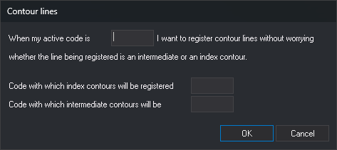

# CONTOUR\_COD
<!-- id: cod-curvas -->
<!-- origen: cc00e256df740f947b9e1c67749a338ace1714f3 -->

Define the code that enables contour line recording and the codes used to record index and intermediate contours.

## Parameters

| Parameter number | Description | Optional |
| :--- | :--- | :--- |
| 1 | Active code that causes lines to be recorded as contours. Supports `*` and `?` wildcards and is case-sensitive | Yes |
| 2 | Code used to record index contours | Yes |
| 3 | Code used to record intermediate contours | Yes |

Separate parameters with spaces. If all three are supplied, the command assigns them without a dialog and ignores any extra parameters. With fewer than three, it ignores the supplied parameters and opens the **Contour lines** dialog with the currently configured codes.

## Notes

Record contour lines without changing codes for each line: the application assigns the index or intermediate code according to Z.

When the first active code matches the first parameter code, [LINE](/digi3d-ai/referencia/ventana-de-dibujo/ordenes/l/linea.md) and POLIGONO record the line with a single code chosen as follows:

* **Index contour**: first vertex Z is a multiple of 5 times [EQUIDISTANCE](/digi3d-ai/referencia/ventana-de-dibujo/variables/e/equidistancia.md). Comparison uses the application precision as tolerance (0.001 by default).
* **Intermediate contour**: any other Z, including Z values that are not multiples of the contour interval.

For example, with an interval of 5, lines recorded at Z 100, 125, and 150 are index contours, and those at Z 105, 110, 115, 120, and 102.5 are intermediate contours. When contours are recorded at interval multiples, there are four intermediate contours between successive index contours.

* The code is determined by **first vertex** Z. Changing Z while recording does not change the code.
* With several active codes, only the first is compared, and the line is recorded with only the index or intermediate code.
* If the index or intermediate code is empty, lines of that type use the active codes.
* If EQUIDISTANCE is 0, all lines use the intermediate contour code.
* Other drawing commands and imported or modified entities are unaffected.

If [AUTOMATIC](/digi3d-ai/referencia/ventana-de-dibujo/variables/a/automatico.md) is enabled, pressing the data button while no command is running starts LINE. The first parameter code must be linear in the code table and support automatic mode. If it matches the point code in [COD\_HEIGHTS](/digi3d-ai/referencia/ventana-de-dibujo/ordenes/c/cod-cotas.md), the application starts HEIGHT instead of LINE.

Codes are held in memory for all drawing windows. They are not saved in the registry: closing the application loses them, and they are empty on startup. To configure them each session, add the command with all three parameters to the startup commands.

To disable contour recording, run without parameters, clear the first code in the dialog, and click **OK**.

The command displays no messages and does not check whether the codes exist in the code table.

## Command characteristics

| Command type | Immediate command |
| :--- | :--- |
| Repeats automatically | No |
| Menu option | Immediate/Special codes/Contour line codes Immediate/Special codes/Automatically select code based on equidistance |
| Toolbar | Automatic commands |
| Extension | DigiNG.OrdenesStandard.dll |
| Implementation | Native |
| Related variables | [EQUIDISTANCE](/digi3d-ai/referencia/ventana-de-dibujo/variables/e/equidistancia.md) — distinguishes index contours from intermediate contours [AUTOMATIC](/digi3d-ai/referencia/ventana-de-dibujo/variables/a/automatico.md) — run LINE when the data button is pressed |
| Related commands | [LINE](/digi3d-ai/referencia/ventana-de-dibujo/ordenes/l/linea.md) [COD\_HEIGHTS](/digi3d-ai/referencia/ventana-de-dibujo/ordenes/c/cod-cotas.md) [CONTOUR\_HEIGHTS](/digi3d-ai/referencia/ventana-de-dibujo/ordenes/c/cotas-curvas.md) [TAG\_CONTOURS](/digi3d-ai/referencia/ventana-de-dibujo/ordenes/r/rotula-curvas.md) |
| Internal name | {ACAEC197-BA66-40cd-B5D0-DD4C349F4BD1} |
