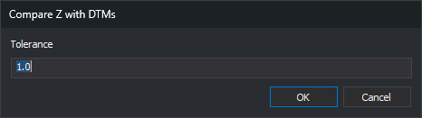

# COMPARE\_Z\_DTM
<!-- id: comparar-z-mdt -->
<!-- origen: f45322aec267883c2efd157e858e57ceffd160c2 -->

Compare entity vertex Z coordinates with the loaded digital terrain model (DTM) and add a task to the Tasks pane for each entity whose difference exceeds a tolerance.

## Parameters

| Parameter number | Description | Optional |
| :--- | :--- | :--- |
| 1...n | Entity codes to compare. Codes support the \* and ? wildcards. A parameter starting with `#` is replaced by all codes with that tag in the code table | Yes. With no parameters, the command asks you to select the entities to compare |

## Compare Z with DTMs dialog

This dialog requests the tolerance.

* **Tolerance**: maximum allowed difference between vertex Z and DTM Z, in reference system units. Defaults to 1.0. Use a period for decimals: a comma causes the decimal part to be ignored (`1,5` is read as 1).
* **OK**: compare entities using that tolerance.
* **Cancel**: end without comparing. Leaving the field empty and clicking **OK** has the same effect.

## Notes

1. If [Empty automatically](../../../cuadros-de-dialogo/configuracion/panel-de-tareas/vaciar-automaticamente.md) is enabled for the Tasks pane, the command empties the pane when you accept the tolerance.
2. If no loaded file can project Z \(a digital terrain model\), the command plays the error sound and ends. This check occurs after requesting the tolerance and, if automatic clearing is enabled, emptying the Tasks pane.
3. The command visits the vertices of each entity. Vertices that cannot be projected onto any model are ignored. At the first difference exceeding the tolerance, it adds an error task locating that vertex with the text "Geometry with Z-coordinate vertices not matching the loaded DTMs". Each analyzed entity produces at most one task.
4. With parameters, the command analyzes all visible, undeleted entities in the drawing file with any specified code and ends without requesting a selection.
5. Without parameters, it compares the entities in each multiple selection and remains active, allowing successive selections with the same tolerance.

## Menu options

* **Geometric analysis/Compare Z with loaded DTMs/Visible geometries**: run the command with `*` to compare all visible entities.
* Below it, the submenu lists an option for each code table tag. Each option compares entities whose codes have that tag.

## Command characteristics

| Command type | [Interactive command](/digi3d-ai/referencia/ordenes/ordenes-interactivas.md) |
| :--- | :--- |
| Repeats automatically | No |
| Menu option | Geometric analysis/Compare Z with loaded DTMs/Visible geometries |
| Toolbar | _This command has no associated toolbar button_ |
| Extension | DigiNG.OrdenesMDT.dll |
| Implementation | Native |
| Related variables | No related variables |
| Related commands | [PROJECT\_BY\_CONDITION](/digi3d-ai/referencia/ventana-de-dibujo/ordenes/p/proyecta-por-condicion.md) |
| Internal name | {08589CEE-2BEA-42BC-AD4E-5F65709CDA35} |
