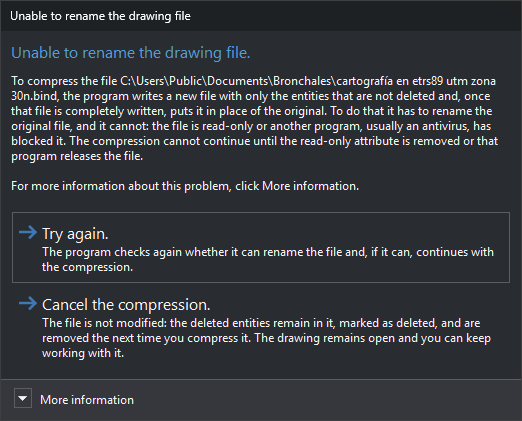

# COMPRESS
<!-- id: comprimir -->
<!-- origen: 4dae3b14dd141c7d8fd24869b5ee284354803285 -->

Remove all entities marked as deleted from the active drawing file.

## Parameters

Does not accept parameters.

## Notes

The command acts on the active drawing file. If its importer/exporter does not support compression, it displays "The importer/exporter of the active drawing file does not allow the file to be compressed." and does nothing.

If [Create back-up copy when compressing](/digi3d-ai/referencia/cuadros-de-dialogo/configuracion/copia-de-seguridad/generar-copia-de-seguridad-al-comprimir.md) is **Yes**, the command backs up the file before compressing it.

The command performs these steps:

1. Unload all topologies from memory.
2. Remove deleted entities from memory and release the memory they occupied.
3. If the format supports it, as `.bin` and `.bind` files do, rewrite the drawing file with only undeleted entities. The file size decreases. If the file is open as read-only, leave it unchanged.
4. Empty the undo operation list.

After running this command, deleted entities cannot be recovered and previous operations cannot be undone.

If another Digi3D.AI instance has the same file loaded as read-only and receives its changes, it displays a message when compression finishes indicating that another instance compressed the file. It then stops receiving file changes because its entities in memory no longer match the compressed file: close and reopen the file in that instance to load the compressed file and receive its changes again. Files detecting external changes, such as `.vec` files, reload automatically and do not display the message.

### Drawing file is locked

To compress a `.bin` or `.bind` file, Digi3D.AI performs these steps:

1. Check that the file can be renamed.
2. Create a new file with the drawing file name plus extension `.comprimiendo` (for example, `dibujo.bin.comprimiendo`), with the original file's permissions, and write undeleted entities to it.
3. Put the new file in place of the original. The resulting file retains the original's attributes (for example, hidden), permissions, creation date, and alternate data streams. The original is renamed with extension `.original` appended.
4. Delete the file with extension `.original`. If deletion fails, display a warning and leave the file in the folder; you can delete it.

If step 2 fails, Digi3D.AI deletes the partially written file and displays a message explaining why; the drawing file remains unchanged. If failure occurs while writing entities, subsequent drawing changes will not be saved to the file: close and reopen the drawing. If the original is left with extension `.original` in step 3 and Digi3D.AI cannot restore its name, the message gives the path of that file, which contains the uncompressed drawing; close the drawing and rename that file to its original name.

If step 1 cannot rename the file because it is read-only or another program, usually an antivirus, has locked it, the **Unable to rename the drawing file** task dialog box appears:

It shows the file path and offers two options:

* **Try again.**: Digi3D.AI checks again whether it can rename the file. If it can, compression continues; otherwise, the dialog box reappears.
* **Cancel the compression.**: Digi3D.AI leaves the file unchanged. Deleted entities remain in the file marked as deleted and will be removed next time it is compressed. The drawing stays open and you can keep working. Deleted entities are no longer in memory, so they cannot be recovered in this session; reopening the file loads them again with the deletion mark. Other Digi3D.AI instances receive no compression notification.

**More information** describes the compression steps and suggests removing the read-only attribute, closing the program locking the file, or disabling the antivirus before clicking **Try again**.

If step 3 cannot put the new file in place of the original, the **Unable to replace the drawing file** task dialog box shows both file paths and the Windows error:

* **Try again.**: Digi3D.AI tries again to put the new file in place of the original and, if successful, finishes compression.
* **Cancel the compression.**: Digi3D.AI deletes the new file. The drawing file remains unchanged, but subsequent drawing changes will not be saved to it: close and reopen the drawing. If another program has the new file open, Digi3D.AI cannot delete it, and the `.comprimiendo` file remains in the folder; you can delete it.

## Command characteristics

| Command type | [Immediate command](/digi3d-ai/referencia/ordenes/ordenes-no-interactivas.md) |
| :--- | :--- |
| Repeats automatically | No |
| Menu option | File/Tools/Compress |
| Toolbar | _This command has no associated toolbar button_ |
| Extension | DigiNG.OrdenesStandard.dll |
| Implementation | Native |
| Related variables | No related variables |
| Related commands | [RECOVER](/digi3d-ai/referencia/ventana-de-dibujo/ordenes/r/recupera.md) [RECOVER\_COD](/digi3d-ai/referencia/ventana-de-dibujo/ordenes/r/recupera-cod.md) |
| Internal name | {B1032F97-7A85-4f2b-8CC1-F665DB1FC57E} |
