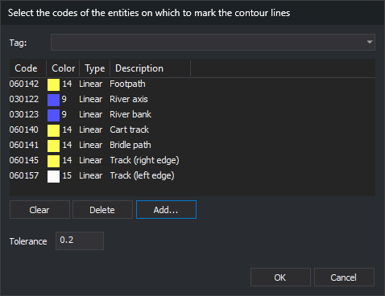

# CONFIGURE\_SHOW\_CONTOUR\_PASS
<!-- id: configurar-mostrar-paso-curvas -->
<!-- origen: 92ae20d911444039861b1b586b26bec00e308f76 -->

Configure the tolerance and codes used to display contour crossings \(variable [SHOW\_CONTOUR\_PASS](/digi3d-ai/referencia/ventana-de-dibujo/variables/m/mostrar_paso_curvas.md)\).

## Parameters

| Parameter number | Description | Optional |
| :--- | :--- | :--- |
| 1 | Z tolerance, in the same units as the drawing files' Z coordinates. Use a decimal point. | Yes |
| 2...n | Codes of the lines to analyze. Support the `*` wildcard. A parameter starting with `#` is replaced by all codes assigned that tag in the code table. | Yes |

The command only uses parameters if it receives at least two \(the tolerance and one code\). With fewer than two, it displays the dialog box.

## Notes

1. The dialog box is [Select codes](/digi3d-ai/referencia/cuadros-de-dialogo/selecciona-codigos.md), with a **Tolerance** field below the list. The first time, the list is empty, and the tolerance is 0.2. On subsequent runs, it displays the configured codes and tolerance. Canceling the dialog box retains the previous configuration.

   

2. The configuration lasts until Digi3D.AI closes: it is not saved and is shared by all drawing files.
3. When finished, the command recalculates marked spans with the new configuration.
4. With the variable enabled and Z locked, the program marks spans of undeleted line entities in all loaded drawing files that have any of the codes and whose Z range contains the active Z. For each line, it marks portions whose Z is between active Z minus tolerance and active Z plus tolerance.
5. Spans are recalculated whenever [Z](/digi3d-ai/referencia/ventana-de-dibujo/variables/z/z.md), [FIXZ](/digi3d-ai/referencia/ventana-de-dibujo/variables/f/fijaz.md), [MOVESUP\_Z](/digi3d-ai/referencia/ventana-de-dibujo/ordenes/s/sube-z.md), or [MOVE DOWN\_Z](/digi3d-ai/referencia/ventana-de-dibujo/ordenes/b/baja-z.md) changes Z or the Z lock. [LOCK\_Z](/digi3d-ai/referencia/ventana-fotogrametrica/ordenes/b/bloquea-z.md) does not recalculate them.
6. Spans are drawn as an animated red and white dashed line with a mark at each vertex, in the drawing and photogrammetric windows. They are not part of any drawing file or selection and cannot be edited.

## Command characteristics

| Command type | Immediate command |
| :--- | :--- |
| Repeats automatically | No |
| Menu option | Immediate/Snaps/Configure curve pass... |
| Toolbar | Snap \(Show curve pass button drop-down\) |
| Extension | DigiNG.OrdenesStandard.dll |
| Implementation | Native |
| Related variables | [SHOW\_CONTOUR\_PASS](/digi3d-ai/referencia/ventana-de-dibujo/variables/m/mostrar_paso_curvas.md) — enable or disable the display of contour crossings |
| Related commands | [FIXZ](/digi3d-ai/referencia/ventana-de-dibujo/variables/f/fijaz.md), [Z](/digi3d-ai/referencia/ventana-de-dibujo/variables/z/z.md) |
| Internal name | {FEB6782B-86C0-43C4-A5B4-2AE8B5D13F26} |
