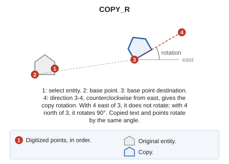

# COPY\_R
<!-- id: copia-r -->
<!-- origen: 11293bf3412fa6426e8189de31259c045dae5045 -->

Copy a drawing entity and rotate it with a second input point.

## Parameters

| Parameter number | Description | Optional |
| :--- | :--- | :--- |
| 1...n | Selectable [geometry types](/digi3d-ai/referencia/ventana-de-dibujo/tipos-de-geometria.md), as letters in one or more parameters: `L P` is equivalent to `LP` | Yes |

## Notes

1. Select the entity to copy.
2. Digitize the base point.
3. Digitize the base point destination.
4. Digitize a fourth point. The copy rotates by the angle of the direction from the third point to the fourth, measured counterclockwise from east. If the fourth point is east of the third, the copy does not rotate; if north, it rotates 90°. Copied text and points rotate by the same angle.

If [REPEAT](/digi3d-ai/referencia/ventana-de-dibujo/variables/r/repite.md) is enabled, the command retains the entity and base point, then prompts again for the destination and rotation of another copy.

## Command characteristics

| Command type | [Interactive command](/digi3d-ai/referencia/ordenes/ordenes-interactivas.md) |
| :--- | :--- |
| Repeats automatically | No |
| Menu option | _This command has no associated menu option_ |
| Toolbar | _This command has no associated toolbar button_ |
| Extension | DigiNG.OrdenesStandard.dll |
| Implementation | Native |
| Related variables | [AA](/digi3d-ai/referencia/ventana-de-dibujo/variables/a/aa.md) — active angle [FORCE\_ACTIVE\_AA](/digi3d-ai/referencia/ventana-de-dibujo/variables/f/forzar-aa-activa.md) — force the active angle (AA) on generated entities [FORCE\_TH\_ACTIVE](/digi3d-ai/referencia/ventana-de-dibujo/variables/f/forzar-at-activa.md) — force the active height (TH) on generated entities [FORCE\_ACTIVE\_CODE](/digi3d-ai/referencia/ventana-de-dibujo/variables/f/forzar-codigo-activo.md) — force the active code on generated entities [FORCE\_ACTIVE\_JT](/digi3d-ai/referencia/ventana-de-dibujo/variables/f/forzar-jt-activa.md) — force the active justification (JT) on generated entities [JT](/digi3d-ai/referencia/ventana-de-dibujo/variables/j/jt.md) — text justification [REPEAT](/digi3d-ai/referencia/ventana-de-dibujo/variables/r/repite.md) — repeat the last command executed |
| Related commands | [COPYP](/digi3d-ai/referencia/ventana-de-dibujo/ordenes/c/copia-2p.md) [COPY](/digi3d-ai/referencia/ventana-de-dibujo/ordenes/c/copiar.md) [DUP](/digi3d-ai/referencia/ventana-de-dibujo/ordenes/d/dup.md) [DUPLICATE](/digi3d-ai/referencia/ventana-de-dibujo/ordenes/d/duplica.md) |
| Internal name | {BC545BCF-6444-4D86-BBA7-DDF1238E337C} |
