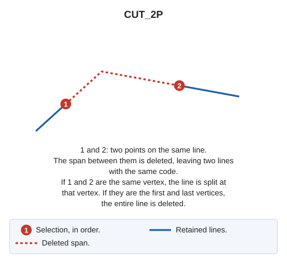

# CUT\_2P
<!-- id: corta-2p -->
<!-- origen: 1aa9e0430318e4422468187e189e27eb34f1ea2e -->

Split an entity at two points on it.

## Parameters

Does not accept parameters.

## Notes

Select the two points at which to split the entity. The command deletes the span between them.

If quality control rejects either new portion, the original entity is preserved whole, and no portions are added.

## Command characteristics

| Command type | [Interactive command](/digi3d-ai/referencia/ordenes/ordenes-interactivas.md) |
| :--- | :--- |
| Repeats automatically | Yes |
| Menu option | Edit/Polylines/Split a polyline with 2 points |
| Toolbar | Leave |
| Extension | DigiNG.OrdenesStandard.dll |
| Implementation | Native |
| Related variables | [REPEAT](/digi3d-ai/referencia/ventana-de-dibujo/variables/r/repite.md) — repeat the last command executed |
| Related commands | [CUT\_E](/digi3d-ai/referencia/ventana-de-dibujo/ordenes/c/cortar-e.md) [CUT\_AND\_DELETE](/digi3d-ai/referencia/ventana-de-dibujo/ordenes/c/cortar-y-borrar.md) |
| Internal name | {A54159B2-7291-4bdb-8FF2-E5B26B9A211D} |
