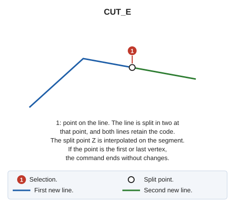

# CUT\_E
<!-- id: cortar-e -->
<!-- origen: d2e4ea6ac1922aa11057f521305ea548e4d0fcf4 -->

Split an element into two elements.

## Parameters

Does not accept parameters.

If quality control rejects either new portion, the original entity is preserved whole, and no portions are added.

## Command characteristics

| Command type | [Interactive command](/digi3d-ai/referencia/ordenes/ordenes-interactivas.md) |
| :--- | :--- |
| Repeats automatically | Yes |
| Menu option | Edit/Polylines/Split a polyline |
| Toolbar | Leave |
| Extension | DigiNG.OrdenesStandard.dll |
| Implementation | Native |
| Related variables | [REPEAT](/digi3d-ai/referencia/ventana-de-dibujo/variables/r/repite.md) — repeat the last command executed |
| Related commands | [CUT\_2P](/digi3d-ai/referencia/ventana-de-dibujo/ordenes/c/corta-2p.md) [CUT\_AND\_DELETE](/digi3d-ai/referencia/ventana-de-dibujo/ordenes/c/cortar-y-borrar.md) |
| Internal name | {4FE96D61-BD2E-437c-8B2E-AD77CC97E4E3} |
