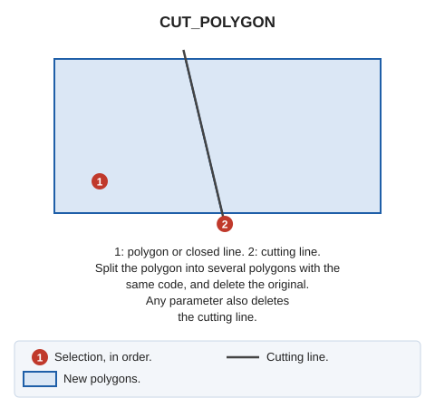

# CUT\_POLYGON
<!-- id: cortar-poligono -->
<!-- origen: c7b994bfed51991da466dbaf74f8a959a1564ac5 -->

Split a polygon into several polygons at intersections with a cutting line.

## Parameters

| Parameter number | Description | Values | Optional |
| :--- | :--- | :--- | :--- |
| 1 | Delete the cutting line | Any value, such as 1 | Yes |

## Notes

Procedure:

1. Select the polygon to modify. Only polygons \(with or without holes\) in the active drawing file can be selected. Other entity types and polygons from reference files cannot be selected.
2. Select the cutting line.
3. Analyze its intersections with the polygon.
   * If it does not intersect the polygon, display a balloon explaining this and do nothing.
   * If it intersects only holes \(without intersecting the polygon boundary\), display a balloon explaining this and do nothing.
4. Split the polygon at the calculated cutting line intersections.

Delete the original polygon from the drawing file.

Generated polygons retain the original code. If database-linked, retain the polygon index.

## Command characteristics

| Command type | [Interactive command](/digi3d-ai/referencia/ordenes/ordenes-interactivas.md) |
| :--- | :--- |
| Repeats automatically | No |
| Menu option | Edit/Polygons/Cut polygon |
| Toolbar | _This command has no associated toolbar button_ |
| Extension | DigiNG.Commands.dll |
| Implementation | [.NET](/digi3d-ai/programacion/.net/README.md) |
| Source code | [CortarPoligono.cs](https://github.com/digi21/DigiNG.Commands/blob/main/DigiNG.Commands/Operaciones%20con%20entidades/CortarPoligono.cs) |
| Related variables | No related variables |
| Related commands | [TRIM\_POLYGON](/digi3d-ai/referencia/ventana-de-dibujo/ordenes/r/recortar-poligono.md) [TRIM\_POLYGONS](/digi3d-ai/referencia/ventana-de-dibujo/ordenes/r/recortar-poligonos.md) |
