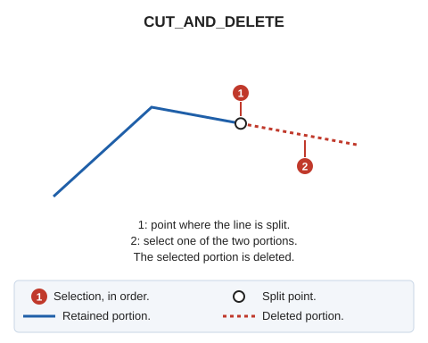

# CUT\_AND\_DELETE
<!-- id: cortar-y-borrar -->
<!-- origen: 973a358051890a0f0ea9d2e8e4a8e86e7573868e -->

Split an element into two elements, then delete one of them.

## Parameters

Does not accept parameters.

If quality control rejects either new portion, the original entity is preserved whole, and no portions are added.

## Command characteristics

| Command type | [Interactive command](/digi3d-ai/referencia/ordenes/ordenes-interactivas.md) |
| :--- | :--- |
| Repeats automatically | Yes |
| Menu option | Edit/Polylines/Split a polyline and delete one of the two ends |
| Toolbar | Leave |
| Extension | DigiNG.OrdenesStandard.dll |
| Implementation | Native |
| Related variables | [REPEAT](/digi3d-ai/referencia/ventana-de-dibujo/variables/r/repite.md) — repeat the last command executed |
| Related commands | [CUT\_2P](/digi3d-ai/referencia/ventana-de-dibujo/ordenes/c/corta-2p.md) [CUT\_E](/digi3d-ai/referencia/ventana-de-dibujo/ordenes/c/cortar-e.md) |
| Internal name | {2D4EAA24-227B-40E4-9E9A-2D189706CD40} |
