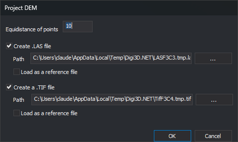

# CREATE\_DEM
<!-- id: crea-dem -->
<!-- origen: acee3616f7f4658c73a238c7961f6d7833ae0f1c -->

Generate a new triangulation from existing mapping inside the selected boundary, project a regular grid of points onto it, and save the results to a LAS file, a GeoTIFF file, or both.

## Parameters

This command takes no parameters.

## Notes

1. In the **Project DEM** dialog, specify the grid spacing \(**Equidistance of points**, in reference system units\), whether to create LAS and TIFF files, their paths, and whether to load them as reference files when finished.

   

   * **Equidistance of points**: defaults to 10. Clicking **OK** saves the value for the next run.
   * **Create .LAS file** and **Create a .TIF file**: both are checked by default. **OK** is disabled when neither is checked.
   * **Path**: the proposed paths are new temporary files in `%TEMP%\<versión de Digi3D.AI>`. The **...** button lets you choose another path.
   * **Load as a reference file**: unchecked by default.

   If the grid spacing is zero or negative, the command displays "The equidistance value must be greater than 0.0" and ends.

2. Select the line to use as the boundary.

The LAS file contains grid points inside the boundary that can be projected onto the triangulation. If no points can be projected, no LAS file is created and no warning appears. If the LAS file cannot be created, the message "Error when creating temporary file..." appears.

The TIFF file is a 32-bit floating-point raster covering the bounding rectangle of the boundary, with a no-data value of -32767. Its georeferencing places the upper-left raster corner at the northwest corner of the bounding rectangle, with square cells whose side length equals the grid spacing. Each cell contains the triangulation Z at its center, or -32767 if the center lies outside the triangulation.

## Command characteristics

| Command type | [Interactive command](../../../ordenes/ordenes-interactivas.md) |
| :--- | :--- |
| Repeats automatically | No |
| Menu option | DTM/Create DEM... |
| Toolbar | Triangulation |
| Extension | DigiNG.OrdenesMDT.dll |
| Implementation | Native |
| Related variables | No related variables |
| Related commands | [TRIANGULATE](/digi3d-ai/referencia/ventana-de-dibujo/ordenes/t/triangular.md) |
| Internal name | {3B6F710E-0DFD-46E0-A5B6-407DB853C480} |
