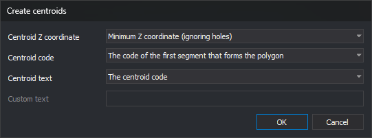

# CREATE\_CENTROIDS
<!-- id: crear-centroides -->
<!-- origen: 1eee8b02cfb2530df35d7aa79b512da6ecf452ae -->

Create a centroid in each polygon without one in loaded topologies, within the part belonging to the active drawing file.

## Parameters

| Parameter number | Description | Values | Optional |
| :--- | :--- | :--- | :--- |
| 1...n | Topology names to process. Each name not matching a loaded topology plays the error sound and displays "Topology not found: name". Repeated names, including case variants, are processed once | Topology names | Yes. With none, process all loaded topologies |

## Notes

At least one topology must be loaded. Otherwise, the command plays the error sound, displays "There is no topology file loaded", and ends. If no supplied name matches a loaded topology, it ends without opening the dialog.

### Dialog

The **Create centroids** dialog requests:

| Field | Description | Default value |
| :--- | :--- | :--- |
| Centroid's Z coordinate | **Minimum Z-coordinate (without taking into account the holes)** or **Maximum Z-coordinate (without taking into account the holes)**, calculated from outer boundary line vertices; **Minimum Z-coordinate (taking into account the holes)** or **Maximum Z-coordinate (taking into account the holes)**, from boundary and hole vertices; **Polygon height**, the difference between maximum and minimum Z across boundary and hole vertices; or **Coordinate 0.0** | Minimum Z-coordinate (without taking into account the holes) |
| Centroid's code | **The one of the first entity which forms the polygon** (first code of the first outer boundary line); **The code whose perimeter is greater** (sum outer boundary line lengths in the X,Y plane grouped by first code, then choose the greatest sum; ties use the alphabetically smallest code); or **The active code** (first active code) | The one of the first entity which forms the polygon |
| Centroid's text | **The code of the centroid**; **Polygon height**, **Minimum polygon Z**, or **Maximum polygon Z**, calculated from outer boundary and hole vertices and formatted with [NDEC](/digi3d-ai/referencia/ventana-de-dibujo/variables/n/ndec.md) decimal places; or **Personalized text** | The code of the centroid |
| Custom text | Text assigned to every centroid. Enabled only with **Personalized text** | Empty |

With **Personalized text** and an empty field, **Accept** is disabled.

Values are not remembered: the dialog uses the defaults each run.

**Cancel** ends without changes.

### Operation

Only the part of each topology belonging to the active drawing file is processed. A text entity is created in each polygon without a centroid. A polygon whose centroid was deleted, for example with [UNDO](/digi3d-ai/referencia/ventana-de-dibujo/ordenes/u/undo.md), counts as having none. A hole receives no centroid as part of its containing polygon; if its interior forms another polygon, that polygon receives its own centroid. An area belonging to two processed topologies receives one centroid for each.

Centroids are placed inside polygons and outside their holes, including concave polygons. The command tests horizontal lines between vertex Y coordinates of the boundary and holes, takes the center of the widest interior section on each, and chooses the point farthest from the boundary. If no valid position is found, the polygon remains without a centroid.

The centroid uses [AA](/digi3d-ai/referencia/ventana-de-dibujo/variables/a/aa.md) angle, [TH](/digi3d-ai/referencia/ventana-de-dibujo/variables/a/at.md) height, and [JT](/digi3d-ai/referencia/ventana-de-dibujo/variables/j/jt.md) justification.

Created centroids are incorporated into the loaded topology without recalculating it. Running again does not duplicate incorporated centroids, and other topology commands treat them as the centroids of their polygons.

[UNDO](/digi3d-ai/referencia/ventana-de-dibujo/ordenes/u/undo.md) reverses all centroids created by the command in one operation.

## Command characteristics

| Command type | Immediate command |
| :--- | :--- |
| Repeats automatically | No |
| Menu option | Topology/Create centroids automatically.../All topologies runs the command without parameters. The same submenu has an option for each loaded topology, running the command with its name as a parameter. Options are disabled when no topology is loaded |
| Toolbar | _This command has no associated toolbar button_ |
| Extension | DigiNG.OrdenesTopologia.dll |
| Implementation | Native |
| Related variables | [AA](/digi3d-ai/referencia/ventana-de-dibujo/variables/a/aa.md) — set the active angle [TH](/digi3d-ai/referencia/ventana-de-dibujo/variables/a/at.md) — set the text height [JT](/digi3d-ai/referencia/ventana-de-dibujo/variables/j/jt.md) — change text justification on insertion [NDEC](/digi3d-ai/referencia/ventana-de-dibujo/variables/n/ndec.md) — number of decimal places |
| Related commands | [DETECT\_POLYGONS\_WITHOUT\_CENTROID\_LOADED\_TOPOLOGIES](/digi3d-ai/referencia/ventana-de-dibujo/ordenes/d/detectar-poligonos-sin-centroide-topologias-cargadas.md) [UNDO](/digi3d-ai/referencia/ventana-de-dibujo/ordenes/u/undo.md) |
| Internal name | {E6B3BAA5-7326-4976-A759-51C8660DDFAF} |
