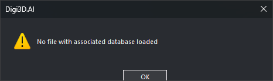

# CREATE\_BBDD\_VIEW
<!-- id: crear-vista-bbdd -->
<!-- origen: 6194736403d395bbd0284eee5cd47324811ec04f -->

Create a virtual drawing file displaying a database field's value over entities in a drawing file linked to a database.

## Parameters

Does not accept parameters.

## Create a database view dialog box

Choose the drawing file from which to create the view. The drop-down lists only loaded drawing files with associated databases. **OK** stays disabled until a file is selected.

If no database-linked file is loaded, display "No file with associated database loaded" and end.

## Notes

Click **OK** to add a reference file named "Database view of *file*" and show the [Drawing file](../../../paneles/archivos-de-dibujo.md) pane. The view writes a field's value inside a rectangle with a background, or *NULL* if empty. Text starts at the entity center. Display it only for undeleted entities whose centers are on screen and for codes whose table is selected.

Nothing appears until a table and field are selected.

View properties in the Drawing file pane allow these choices:

* **Table**: database table supplying the value. Changing it clears **Field**.
* **Field**: field of that table to display.
* **Background color**: text rectangle color. Default: blue.
* **Text color**: text color. Default: white.
* **Height**: text size in pixels. Default: 20.

## Command characteristics

| Command type | [Immediate command](/digi3d-ai/referencia/ordenes/ordenes-no-interactivas.md) |
| :--- | :--- |
| Repeats automatically | No |
| Menu option | Database/Create database view... |
| Toolbar | _This command has no associated toolbar button_ |
| Extension | DigiNG.OrdenesBaseDatos.dll |
| Implementation | Native |
| Related variables | No related variables |
| Related commands | No related commands |
| Internal name | {14169A10-395F-4E9F-BC43-638F2BD80EEE} |
