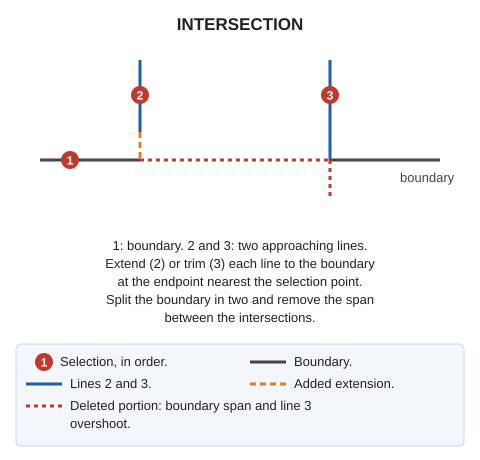

# INTERSECTION
<!-- id: cruce -->
<!-- origen: 105e8bb8d2592826c46b1a636dca38174c4bece8 -->

Create the crossing of one entity with two others and remove the first entity's portion between the two intersections.

## Parameters

This command does not accept parameters.

## Notes

Use this command to draw intersections of tracks, roads, and similar features.

If quality control rejects the first modified line, retain its original. If any new entity from the second step (the second line or either boundary portion) is rejected, retain the original second line and boundary, and add no new entities from that step.

## Command characteristics

| Command type | [Interactive command](/digi3d-ai/referencia/ordenes/ordenes-interactivas.md) |
| :--- | :--- |
| Repeats automatically | Yes |
| Menu option | Edit/Polylines/Create a line cross |
| Toolbar | Extend/Cut |
| Extension | DigiNG.OrdenesStandard.dll |
| Implementation | Native |
| Related variables | [REPEAT](/digi3d-ai/referencia/ventana-de-dibujo/variables/r/repite.md) — repeat the last command executed |
| Related commands | No related commands |
| Internal name | {E46C5B7B-41E3-45fd-9ACC-9D6958ADDB97} |
