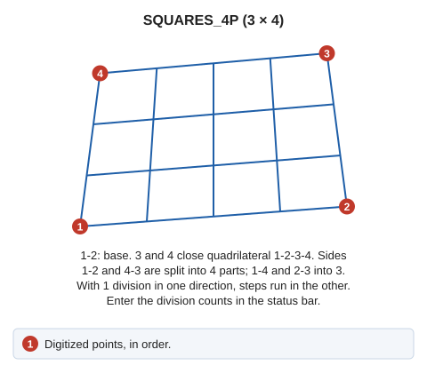

# SQUARES\_4P
<!-- id: cuadros-4p -->
<!-- origen: 27c267f025c03900174b03e1eb50d9f8994a4926 -->

Draw steps or matrices of four-sided polygons.

## Parameters

Does not accept parameters.

## Notes

The command first requests the two points defining the base, then the third and fourth points completing the quadrilateral.

The final drawing can be any of the following:

* A grid.
* Steps only in the direction parallel to the base.
* Steps only in the direction perpendicular to the base.

## Command characteristics

| Command type | [Interactive command](/digi3d-ai/referencia/ordenes/ordenes-interactivas.md) |
| :--- | :--- |
| Repeats automatically | Yes |
| Menu option | Draw/More/Grid with 4 points |
| Toolbar | Grids |
| Extension | DigiNG.OrdenesStandard.dll |
| Implementation | Native |
| Related variables | [REPEAT](/digi3d-ai/referencia/ventana-de-dibujo/variables/r/repite.md) — repeat the last command executed |
| Related commands | [SQUARES](/digi3d-ai/referencia/ventana-de-dibujo/ordenes/c/cuadros.md) |
| Internal name | {CD9C598F-CF2F-4478-A09C-63E28F86260A} |
