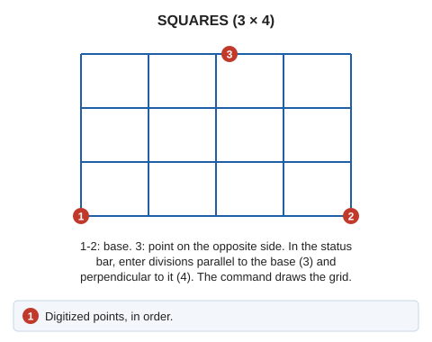

# SQUARES
<!-- id: cuadros -->
<!-- origen: 9ca7f7eae224e82b874bca99891b0f8786163792 -->

Draw segments both parallel and perpendicular to the base.

## Parameters

Does not accept parameters.

## Notes

The visual result resembles a matrix of squares or rectangles. This command works similarly to [LADDER](/digi3d-ai/referencia/ventana-de-dibujo/ordenes/e/escalera.md).

## Command characteristics

| Command type | [Interactive command](/digi3d-ai/referencia/ordenes/ordenes-interactivas.md) |
| :--- | :--- |
| Repeats automatically | Yes |
| Menu option | Draw/More/Grid with 3 points |
| Toolbar | Grids |
| Extension | DigiNG.OrdenesStandard.dll |
| Implementation | Native |
| Related variables | [REPEAT](/digi3d-ai/referencia/ventana-de-dibujo/variables/r/repite.md) — repeat the last command executed |
| Related commands | [SQUARES\_4P](/digi3d-ai/referencia/ventana-de-dibujo/ordenes/c/cuadros-4p.md) [LADDER](/digi3d-ai/referencia/ventana-de-dibujo/ordenes/e/escalera.md) |
| Internal name | {D8557157-D1DA-475b-8988-67474F895E53} |
