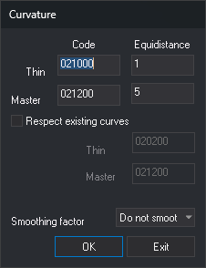

# CURVE
<!-- id: curvar -->
<!-- origen: ffa7e190a9476b487658f4985d149a0596311388 -->

Generate contours from a triangulation.

## Parameters

| Parameter number | Description | Values | Optional |
| :--- | :--- | :--- | :--- |
| 1 | Intermediate contour interval, in reference system units | Real number | No |
| 2 | Index contour interval, in reference system units | Real number | No |
| 3 | Smoothing factor | Integer | No |
| 4 | Code for generated intermediate contours | Code | No |
| 5 | Code for generated index contours | Code | No |

The older seven-parameter format is also accepted; its first and fourth parameters are ignored.

With any other number of parameters, ignore them and display a dialog box with intervals, codes, smoothing factor, and the option to preserve existing contours with their codes.

## Notes

1. Select the boundary line of the area to contour.

Generate a triangulation from existing mapping inside the boundary, calculate contours with cubic spline smoothing, and add them to the drawing file. With parameters, preserve existing contours bearing the specified intermediate and index codes.

## Command characteristics

| Command type | [Interactive command](/digi3d-ai/referencia/ordenes/ordenes-interactivas.md) |
| :--- | :--- |
| Repeats automatically | No |
| Menu option | DTM/Curve... |
| Toolbar | _This command has no associated toolbar button_ |
| Extension | DigiNG.OrdenesMDT.dll |
| Implementation | Native |
| Related variables | [TH](/digi3d-ai/referencia/ventana-de-dibujo/variables/a/at.md) — text height |
| Related commands | [TRIANGULATE](/digi3d-ai/referencia/ventana-de-dibujo/ordenes/t/triangular.md) |
| Internal name | {5F9CD935-26E7-4c30-97EC-456DADB28A08} |
