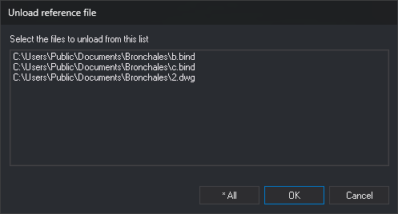

# LEAVE
<!-- id: dejar -->
<!-- origen: 50ce0ba422f5886fa1f1ed1128e5214b90920fed -->

Unload reference files attached to the working file.

## Parameters

| Parameter number | Description | Optional |
| :--- | :--- | :--- |
| 1 | Path of the reference file to unload | Yes |

## Notes

If no reference files are loaded, the command displays an error message and ends.

If you specify the parameter, the command unloads that reference file without displaying a dialog box. Enclose paths containing spaces in double quotation marks.

Path comparison is case-insensitive. If the path does not match any loaded reference file, an error tone sounds, and no file is unloaded.

Without a parameter, if only one reference file is loaded, the command unloads it directly. If several are loaded, it displays the **Leave** dialog box.

When unloading a reference file:

* The command also unloads all loaded topologies, even when the parameter's path does not match any loaded file.
* The command removes the file from the list of reference files associated with the drawing file. That reference file is no longer loaded when you reopen the drawing file.
* If the file is not open as read-only, contains entities marked as deleted, and its format stores that flag within the file itself, Digi3D.AI asks whether to compress it: "There are entities marked as deleted that have not been removed yet: (…) Do you want to compress now?" **Yes** compresses and unloads the file. **No** unloads it without compressing. **Cancel** cancels unloading that file.

## Leave dialog box

Select the reference files to unload in this dialog box.

* **Select the files to be left from this list**: loaded reference files, with their full paths. The drawing file is not listed. Each click on a file selects or deselects it without holding Ctrl or Shift.
* **\* All**: unload all reference files in the list.
* **OK**: unload the selected files. If no file is selected, nothing happens, and the dialog box remains open.
* **Cancel**: close the dialog box without unloading any files.

## Command characteristics

| Command type | [Immediate command](/digi3d-ai/referencia/ordenes/ordenes-no-interactivas.md) |
| :--- | :--- |
| Repeats automatically | No |
| Menu option | File/Unload reference file... |
| Toolbar | _This command has no associated toolbar button_ |
| Extension | DigiNG.OrdenesStandard.dll |
| Implementation | Native |
| Related variables | No related variables |
| Related commands | [LOAD\_F](/digi3d-ai/referencia/ventana-de-dibujo/ordenes/c/carga-f.md) |
| Internal name | {99D6E304-1AE6-4eec-B6E5-D1A438009F11} |
