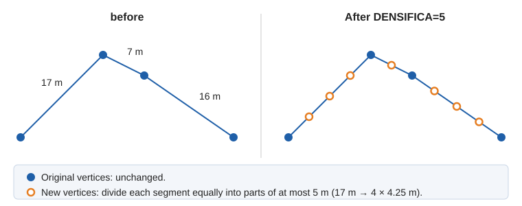
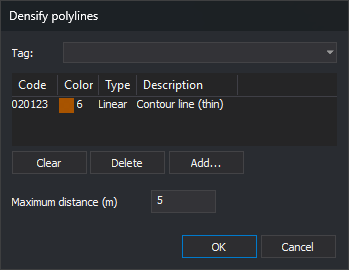

# DENSIFICA
<!-- id: densifica -->
<!-- origen: 1c2e4d5ce93c1e23faeb389470b9cd7c09dbeb41 -->

Insert vertices into lines and polygons with the specified codes so that no segment exceeds the specified maximum distance.

Each segment longer than the maximum distance is divided into equal parts. Original vertices do not move, so the entity's shape does not change.

## Parameters

| Parameter number | Description | Optional |
| :--- | :--- | :--- |
| 1 | Maximum distance between vertices, in meters | Yes |
| 2 and subsequent | Entity codes. Accepts wildcards (`*`, `?`) and code table tags with `#` (for example, `#vcurvas`). | Yes |

### Examples

`DENSIFICA`

Open a dialog box for selecting codes and the distance.

`DENSIFICA=5 020100 020200`

Insert vertices into entities with codes `020100` and `020200` so that no segment exceeds 5 m.

`DENSIFICA=2 #vcurvas`

Insert vertices at intervals of at most 2 m into entities with any code tagged `vcurvas`.

## Dialog box

Without parameters, or with only the distance, the command displays [Select codes](/digi3d-ai/referencia/cuadros-de-dialogo/selecciona-codigos.md) for selecting codes or a code table tag, with a separate **Maximum distance (m)** field. The dialog box suggests the last distance accepted there (5 m the first time it opens). If you specify the distance as a parameter, the dialog box displays it; distances supplied as parameters are not saved.

You can also run it from **Draw/Densify polylines...**.

## Notes

- The command operates on lines, polygons (their outer boundaries and holes), and complex entities (each component entity). Other entities remain unchanged.
- Segment length is measured in plan view: Z is not considered. Even if the drawing file uses geographic coordinates, distance is measured in meters.
- New vertex Z values are linearly interpolated between the segment's two vertices.
- Segments equal to or shorter than the specified distance are not divided.
- Only visible, undeleted entities in the active drawing file and within the area of interest are modified.
- Each densified entity is replaced with a copy containing the new vertices.
- The distance must be greater than 0. Otherwise, the command displays "The maximum distance between vertices must be greater than 0." and changes nothing.
- If a line would exceed 10,000,000 vertices, or a segment cannot be measured, the command displays an error message and modifies no entities.
- Without codes, the command finishes without doing anything.

## See also

- [GEN](/digi3d-ai/referencia/ventana-de-dibujo/ordenes/g/gen.md) and [GEN\_2D](/digi3d-ai/referencia/ventana-de-dibujo/ordenes/g/gen-2d.md) perform the reverse operation, removing vertices.
- [INSERT\_VERTEX](/digi3d-ai/referencia/ventana-de-dibujo/ordenes/i/inserta-vertice.md) inserts a single vertex at the point you specify.

Each entity is handled independently: if Digi3D.AI rejects a densified entity, the original of that rejected copy is preserved, and the other entities are densified.

## Command characteristics

| Command type | [Interactive command](/digi3d-ai/referencia/ordenes/ordenes-interactivas.md) |
| :--- | :--- |
| Repeats automatically | No |
| Menu option | Draw/Densify polylines... |
| Toolbar | _This command has no associated toolbar button_ |
| Extension | DigiNG.OrdenesStandard.dll |
| Implementation | Native |
| Related variables | No related variables |
| Related commands | [GEN](/digi3d-ai/referencia/ventana-de-dibujo/ordenes/g/gen.md) [GEN\_2D](/digi3d-ai/referencia/ventana-de-dibujo/ordenes/g/gen-2d.md) [INSERT\_VERTEX](/digi3d-ai/referencia/ventana-de-dibujo/ordenes/i/inserta-vertice.md) |
| Internal name | {33AB2DA1-4007-4BA9-B637-7F5CDAEA33E3} |
