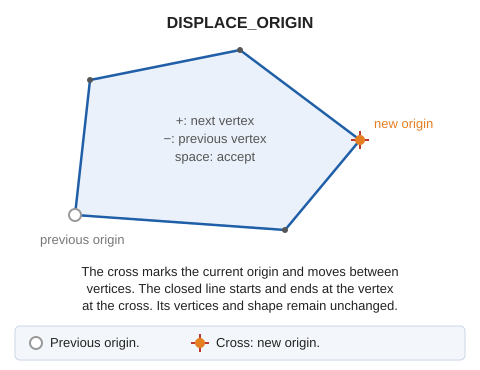

# DISPLACE\_ORIGIN
<!-- id: desplazar-origen -->
<!-- origen: eb9124ceac92f113cc7619348383151a72a8b0e3 -->

Change the origin \(start and end\) of a closed line.

## Parameters

Does not accept parameters.

## Notes

If the origin of a closed entity is in the area you need to modify, you cannot modify that area. Use _DISPLACE\_ORIGIN_ to change the origin.

1. Select the closed line, or the boundary or a hole of a polygon. A cross appears at the current origin.
2. Press **+** or **−** to move the cross to the next or previous vertex.
3. Press **space**. The line now starts and ends at the vertex marked by the cross; its shape does not change.

## Command characteristics

| Command type | [Interactive command](/digi3d-ai/referencia/ordenes/ordenes-interactivas.md) |
| :--- | :--- |
| Repeats automatically | No |
| Menu option | _This command has no associated menu option_ |
| Toolbar | _This command has no associated toolbar button_ |
| Extension | DigiNG.OrdenesStandard.dll |
| Implementation | Native |
| Related variables | No related variables |
| Related commands | No related commands |
| Internal name | {DEB8EC05-421D-4e7f-B3A4-ED5BF9CC7331} |
