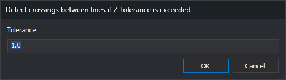

# DETECT\_LINE\_CROSSING\_Z
<!-- id: detectar-cruce-lineas-z -->
<!-- origen: 76f13f3b33a6dc81bb8e83ac14fba6a6262f4a7e -->

Detect line crossings and mark crossings where the lines' Z difference exceeds a tolerance as errors.

## Parameters

| Parameter number | Description | Optional |
| :--- | :--- | :--- |
| 1 | Code or codes (one or more, separated by spaces) | Yes |

## Detect crossings between lines if Z-tolerance is exceeded dialog box

Specify the tolerance in this dialog box.

* **Tolerance**: maximum accepted difference between the two lines' Z values at the crossing, in reference system units. Default: 1.0.
* **OK**: search for crossings using that tolerance.
* **Cancel**: end without searching. Leaving the field empty and clicking **OK** has the same effect.

## Notes

At each crossing where the lines' Z difference, interpolated at the crossing, exceeds the tolerance, create two error tasks in the Tasks pane, one per line. Tasks have the same text as [DETECT\_LINE\_CROSSING](detectar-cruce-lineas.md): "An intersection between lines has been located". Self-intersections are also detected.

Analyze visible lines and polygons \(including holes\) within the area of interest bearing any specified code. Codes support \* and ? wildcards. To include all codes bearing a tag, prefix its name with a number sign \(\#\).

Without codes, wait for a multiple selection, analyze the selected entities, and end.

If the Tasks pane's [Empty automatically](../../../cuadros-de-dialogo/configuracion/panel-de-tareas/vaciar-automaticamente.md) option is enabled, empty the pane when the tolerance is accepted. This option is enabled by default.

Use a decimal point for the tolerance: a comma causes the decimal part to be ignored (`1,5` is read as 1).

## Menu options

* **Geometric analysis/Detect crossings between lines if Z-tolerance is exceeded/Visible lines**: run with parameter `*` to analyze all visible lines.
* Below it, the submenu lists one option per code table tag. Each analyzes lines bearing codes with that tag.

## Command characteristics

| Command type | [Interactive command](/digi3d-ai/referencia/ordenes/ordenes-interactivas.md) |
| :--- | :--- |
| Repeats automatically | No |
| Menu option | Geometric analysis/Detect crossings between lines if Z-tolerance is exceeded/Visible lines |
| Toolbar | _This command has no associated toolbar button_ |
| Extension | DigiNG.OrdenesTopologia.dll |
| Implementation | Native |
| Related variables | No related variables |
| Related commands | [DETECT\_LINE\_CROSSING](/digi3d-ai/referencia/ventana-de-dibujo/ordenes/d/detectar-cruce-lineas.md) [DETECT\_VISIBLE\_LINES\_CROSSING](/digi3d-ai/referencia/ventana-de-dibujo/ordenes/d/detectar-cruce-lineas-visibles.md) |
| Internal name | {DACB177A-0871-415C-BDE5-801586CB9171} |
