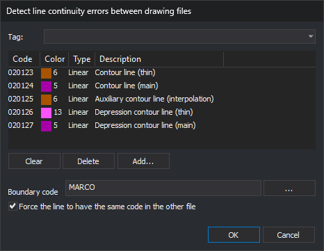

# DETECT\_LINE\_CONTINUITY\_ERRORS\_CASES
<!-- id: detectar-errores-continuidad-lineas-cases -->
<!-- origen: 798d4c16cf879988874fee305a8473a1e599bb5f -->

Detect lines ending at the shared boundary of adjacent drawing files (sheet edges) without continuing into the other file. Optionally, detect continuations with different codes. Errors are added to the [Tasks pane](/digi3d-ai/referencia/paneles/tareas.md).

## Parameters

| Parameter number | Description | Optional |
| :--- | :--- | :--- |
| 1 | Code of lines forming the boundary between drawing files | No |
| 2 | 1 to require matching codes in both files; 0 otherwise. Any nonzero value is equivalent to 1 | No |
| 3 | One or more line codes to analyze. Supports wildcards and `#etiqueta`, meaning all code table codes with that tag | No |

With fewer than three parameters, all supplied parameters are ignored and the dialog opens. If parameter 3 matches no codes \(for example, a tag without codes\), the error sound plays and the command ends.

## Notes

At least two drawing files must be loaded, counting active and reference files. Otherwise, **At least two drawing files are needed to detect continuity errors.** appears and the command ends.

### Dialog

**Detect line continuity errors between drawing files** contains:

| Control | Description |
| :--- | :--- |
| Top drop-down list | Code table tags prefixed with `#`. Choosing one replaces the code list with its tagged codes and clears the drop-down selection |
| Code list | Codes to analyze, with color, type, and description. An empty list analyzes all codes |
| Clear | Empty the code list |
| Delete | Remove the selected code |
| Add... | Open code selection and add the chosen codes |
| Boundary code | Code of shared boundary lines, usually each sheet frame. **...** opens code selection; canceling retains the field value |
| Force the line to have the same code in the other file | Also report continuations with different codes |

The dialog saves **Boundary code** and **Force the line to have the same code in the other file** as `CodigoLimite` and `ForzarMismoCodigo` under registry key `HKEY_CURRENT_USER\Software\Digi21\Digi3D.NET\DigiNG\Extensiones\DigiNG.OrdenesTopololgia\DialogoDetectarErroresContinuidadCases`. Changes are saved immediately, even if you later click **Cancel**. Saved values appear on the next run. The code list is not saved and starts empty each time.

**Cancel** ends without analysis.

### Analysis

1. An empty boundary code plays the error sound, displays **Specify the code of the boundary lines.**, and ends.
2. If [Empty automatically](/digi3d-ai/referencia/cuadros-de-dialogo/configuracion/panel-de-tareas/vaciar-automaticamente.md) is enabled, the Tasks pane is emptied.
3. Select undeleted lines with the boundary code from all loaded drawing files. Split them at intersections and shared vertices, retaining sections coinciding in two or more lines: the common boundary of adjacent files. If none remain, play the error sound, display **No segment of the lines with the boundary code … is shared by two or more drawing files.**, and end.
4. Vertices of those sections are boundary points. Check first and last vertices of every undeleted line with a code to analyze. At each match with a boundary point, record the file and line codes, excluding the boundary code.
5. For each boundary point reached by lines:
   * Lines from only one file produce **Continuity error between models**, with **This line ends at the edge of a model and does not continue through the next model.**
   * With lines from two or more files and matching codes required, compare each file against every other. Each code present in one and absent in another produces **Continuity error between models: code**. The same difference may produce a task in each direction.
   * With lines from two or more files and matching codes not required, there is no error.

Points coincide if their X and Y differences are below **Sigma** on the project [Drawing file](/digi3d-ai/referencia/cuadros-de-dialogo/nuevo-proyecto/archivo-de-dibujo.md) tab \(0.001 by default\). The command has no separate tolerance and does not compare Z.

Only endpoints on a boundary **vertex** are analyzed. A line ending midway along a boundary segment, far from any vertex, is ignored. First run [ADJUST\_DRAWING\_FILE\_LIMITS](/digi3d-ai/referencia/ventana-de-dibujo/ordenes/a/ajusta-limites-archivos-dibujo.md) to insert a boundary vertex wherever a line reaches it.

Each task positions the cursor at the error. Every task file column shows the active drawing file, even when the line belongs to a reference file.

### Result

* Without errors, **No continuity errors have been found.** appears.
* With errors, tasks are added, the error sound plays, **N errors have been found** appears, and the Tasks pane opens.

## Command characteristics

| Command type | Immediate command |
| :--- | :--- |
| Repeats automatically | No |
| Menu option | Geometric analysis/Detect line connectivity errors between files... |
| Toolbar | _This command has no associated toolbar button_ |
| Extension | DigiNG.OrdenesTopologia.dll |
| Implementation | Native |
| Related variables | No related variables |
| Related commands | [ADJUST\_DRAWING\_FILE\_LIMITS](/digi3d-ai/referencia/ventana-de-dibujo/ordenes/a/ajusta-limites-archivos-dibujo.md) [TOPOLOGICAL\_CONTROL\_CASES](/digi3d-ai/referencia/ventana-de-dibujo/ordenes/c/control-topologico-cases.md) [DETECT\_BBDD\_ATTRIBUTE\_ERRORS\_CASES](/digi3d-ai/referencia/ventana-de-dibujo/ordenes/d/detectar-errores-atributos-bbdd-cases.md) |
| Internal name | {991B1568-5815-48B2-9829-7D4E504A8951} |
