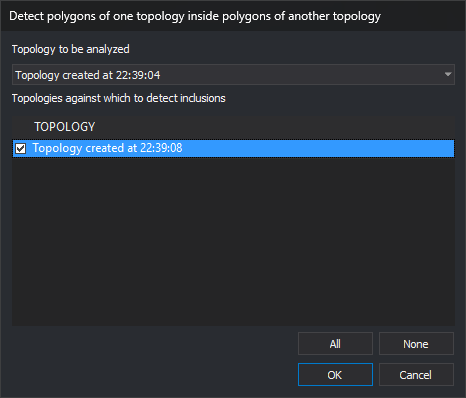

# DETECT\_POLYGONS\_ONE\_TOPOLOGY\_INSIDE\_POLYGONS\_OTHER\_TOPOLOGY
<!-- id: detectar-poligonos-una-topologia-dentro-poligonos-otra-topologia -->
<!-- origen: acdfd05cae7b07b56b854091c360d924e878190b -->

Detect polygons of one topology contained in polygons of other loaded topologies, adding an error for each pair to the [Tasks pane](/digi3d-ai/referencia/paneles/tareas.md).

## Parameters

| Parameter number | Description | Optional |
| :--- | :--- | :--- |
| 1 | Topology whose polygons are checked | Yes |
| 2 onward | Topologies whose polygons may contain those of the first topology | Yes |

## Notes

At least two topologies must be loaded. With none, "No topology loaded" appears; with one, "At least two topologies must be loaded" appears. Both cases play the error sound and end the command. The menu option is disabled with fewer than two topologies.

With two or more parameters, the command compares the first topology with the subsequent topologies without opening the dialog. Names are compared case-insensitively, and repeated names are processed only once. A warning appears, the error sound plays, and no checks are performed in these cases:

* A topology is not loaded: "Topology X is not loaded".
* The first topology also appears among the others: "The topology to analyze cannot also be one of the topologies it is compared with".

With one or no parameters, the parameter is ignored and the dialog opens.

### Dialog

The **Detect polygons of one topology within polygons of another topology** dialog requests:

| Field | Description | Default value |
| :--- | :--- | :--- |
| Topology to be analyzed | Topology whose polygons are checked. Loaded topologies are listed alphabetically by name | First in the list |
| Topologies against which to detect inclusions | Topologies whose polygons may contain those of the topology to analyze. Lists the other loaded topologies, with a checkbox for each row | None checked |

**All** checks all listed topologies; **None** unchecks them. Changing the topology to analyze repopulates the list without that topology and preserves the other checked selections. **OK** is enabled only when at least one topology is checked.

Values are not remembered: the dialog uses the defaults each time.

**Cancel** ends without checking anything.

### Operation

The command compares every polygon of the topology to analyze with every polygon of the checked topologies. Each topology contributes polygons from all drawing files in which it is loaded: the active file and reference files.

A polygon comprises its outer boundary area minus its holes. The following are ignored in all topologies:

* Polygons without a centroid in a topology that does not form polygons without centroids.
* Polygons whose centroid text matches the topology [centroid for holes](/digi3d-ai/referencia/editor-de-tablas-de-codigos/pestanas/topologias/anadir-topologia.md).

Polygon A is inside polygon B if the whole area of A belongs to B:

* The boundary of A may coincide partly or entirely with B. Equal polygons count as one inside the other.
* A is not inside B if any part lies outside B, inside a hole of B, or in a concave indentation, even if all vertices of A are inside B.
* Coordinates less than half a model precision unit apart are treated as the same point.

For every pair in which a polygon of the topology being analyzed is inside a polygon of another topology, the command adds an error to the Tasks pane with "Topology polygon: A within topology polygon: B". The task coordinate is the first outer boundary vertex of the contained polygon, and its file is the active drawing file.

When finished, "Polygons inside polygons of another topology: N" appears. If any were found, the error sound plays.

During checking, the command displays the wait cursor and percentage completed. Only polygons with touching bounding rectangles are compared. Time depends mainly on the vertex count in those pairs.

The drawing is not modified.

## Command characteristics

| Command type | Immediate command |
| :--- | :--- |
| Repeats automatically | No |
| Menu option | Topology/Detect polygons of one topology within polygons of another topology/Of a topology against selected... |
| Toolbar | _This command has no associated toolbar button_ |
| Extension | DigiNG.OrdenesTopologia.dll |
| Implementation | Native |
| Related variables | No related variables |
| Related commands | [DETECT\_TOPOLOGY\_OVERLAPS](/digi3d-ai/referencia/ventana-de-dibujo/ordenes/d/detectar-solapes-topologias.md) |
| Internal name | {42C16C41-2492-4B10-AE22-D080310A73D3} |
