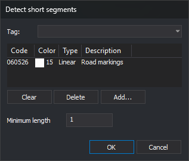

# DETECT\_SHORT\_SEGMENTS
<!-- id: detectar-segmentos-cortos -->
<!-- origen: 8220254b4cd397ef8c613ba75e3fa642a4d3c9cd -->

Find segments shorter than a minimum length in lines and polygons with the specified codes, adding an error task to the Tasks pane for each entity containing any. The drawing is unchanged; use [REMOVE\_SHORT\_SEGMENTS](/digi3d-ai/referencia/ventana-de-dibujo/ordenes/e/eliminar-segmentos-cortos.md) to remove those segments.

## Parameters

| Parameter number | Description | Optional |
| :--- | :--- | :--- |
| 1 | Minimum segment length. Must be a number greater than 0 | Yes |
| 2 onward | Entity codes. Supports wildcards (`*`, `?`) and code table tags with `#` (for example, `#vias_de_comunicacion`) | Yes |

### Examples

`DETECT_SHORT_SEGMENTS`

Open a dialog to choose codes and minimum length.

`DETECT_SHORT_SEGMENTS=0.5 060526 0605*`

Find segments shorter than 0.5 units in entities with code `060526` or codes starting with `0605`.

`DETECT_SHORT_SEGMENTS=1 #vias_de_comunicacion`

Find segments shorter than 1 unit in entities with codes tagged `vias_de_comunicacion`.

## Dialog

Running without parameters, or with only a length, opens [Select codes](/digi3d-ai/referencia/cuadros-de-dialogo/selecciona-codigos.md) titled **Detect short segments**. A length supplied alone is ignored: the dialog uses its saved length.

Below the code list is an additional field:

| Field | Description | Default value |
| :--- | :--- | :--- |
| Minimum length | Minimum horizontal segment length. Must be a number greater than 0 | Last accepted length; initially 1 |

**OK** is enabled only when the list contains at least one code and minimum length is a number greater than 0. Clicking **OK** saves the length in `LongitudMinima` under registry key `HKEY_CURRENT_USER\Software\Digi21\Digi3D.NET\DigiNG\Extensiones\DigiNG.OrdenesTopologia\DetectarSegmentosCortos`. REMOVE\_SHORT\_SEGMENTS uses the same value. The code list is not saved: it starts empty each run.

**Cancel** ends without analyzing anything.

## Notes

* The command analyzes undeleted, visible lines and polygons in the active drawing file, inside the area of interest, with any specified code. Polygon outer boundaries and holes are analyzed separately. Other entities, including complex entities, are ignored.
* A segment joins two consecutive vertices. Length is measured horizontally, ignoring Z. A segment is short if its length is strictly less than the minimum. Lines or holes with fewer than two vertices have no segments and are ignored.
* For projected \(UTM, Lambert, etc.\) or local drawing window coordinate reference systems, length is in coordinate units. For geographic systems, each boundary and hole is projected into an oblique stereographic projection originating at its first vertex, and length is in meters.
* Each entity containing a short segment produces a **Detected short segment** error task that zooms to it. Each short segment has a **Segment N units long** subtask that centers the view on its midpoint.
* If [Empty automatically](/digi3d-ai/referencia/cuadros-de-dialogo/configuracion/panel-de-tareas/vaciar-automaticamente.md) is enabled, the Tasks pane is emptied before analysis, whether parameters are supplied or the dialog is accepted. It is emptied after validating minimum length: an invalid length or **Cancel** leaves the pane unchanged.
* If the length parameter is not a number greater than 0, "The minimum segment length must be a number greater than 0." appears, the error sound plays, and nothing is analyzed.
* No entity is modified and nothing is added to [UNDO](/digi3d-ai/referencia/ventana-de-dibujo/ordenes/u/undo.md) history.

## Command characteristics

| Command type | [Interactive command](/digi3d-ai/referencia/ventana-de-dibujo/ordenes-interactivas.md) without parameters; immediate command with parameters |
| :--- | :--- |
| Repeats automatically | No |
| Menu option | Geometric analysis/Detect short segments... |
| Toolbar | _This command has no associated toolbar button_ |
| Extension | DigiNG.OrdenesTopologia.dll |
| Implementation | Native |
| Related variables | No related variables |
| Related commands | [REMOVE\_SHORT\_SEGMENTS](/digi3d-ai/referencia/ventana-de-dibujo/ordenes/e/eliminar-segmentos-cortos.md) |
| Internal name | {C91882C6-2398-4E30-8C3B-39E1BC404237} |
