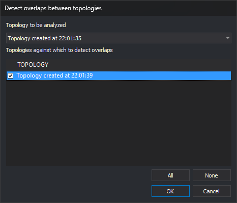

# DETECT\_TOPOLOGY\_OVERLAPS
<!-- id: detectar-solapes-topologias -->
<!-- origen: 9931ba11f4e8c72357e251368fd00dd751756d1d -->

Detect polygons of one topology overlapping polygons of other loaded topologies, adding an error for each pair to the [Tasks pane](/digi3d-ai/referencia/paneles/tareas.md).

## Parameters

| Parameter number | Description | Optional |
| :--- | :--- | :--- |
| 1 | Topology whose polygons are checked | Yes |
| 2 onward | Topologies to compare against | Yes |

## Notes

At least two topologies must be loaded. With none, "No topology loaded" appears; with one, "At least two topologies must be loaded" appears. Both cases play the error sound and end the command. The menu option is disabled with fewer than two topologies.

With two or more parameters, the command compares the first topology with the subsequent topologies without opening the dialog. Names are compared case-insensitively, and repeated names are processed only once. A warning appears, the error sound plays, and no checks are performed in these cases:

* A topology is not loaded: "Topology X is not loaded".
* The first topology also appears among the others: "The topology to analyze cannot also be one of the topologies it is compared with".

With one or no parameters, the parameter is ignored and the dialog opens.

### Dialog

The **Detect overlaps between topologies** dialog requests:

| Field | Description | Default value |
| :--- | :--- | :--- |
| Topology to be analyzed | Topology whose polygons are checked. Loaded topologies are listed alphabetically by name | First in the list |
| Topologies against which to detect overlaps | Topologies whose polygons are compared with the topology to analyze. Lists the other loaded topologies, with a checkbox for each row | None checked |

**All** checks all listed topologies; **None** unchecks them. Changing the topology to analyze repopulates the list without that topology and preserves the other checked selections. **OK** is enabled only when at least one topology is checked.

Values are not remembered: the dialog uses the defaults each time.

**Cancel** ends without checking anything.

### Operation

The command compares every polygon of the topology to analyze with every polygon of the checked topologies. Each topology contributes polygons from all drawing files in which it is loaded: the active file and reference files.

A polygon comprises its outer boundary area minus its holes. The following are ignored in all topologies:

* Polygons without a centroid in a topology that does not form polygons without centroids.
* Polygons whose centroid text matches the topology [centroid for holes](/digi3d-ai/referencia/editor-de-tablas-de-codigos/pestanas/topologias/anadir-topologia.md).

Two polygons overlap if their surfaces share an area:

* They overlap if their boundaries cross, if one is inside the other even with a shared boundary section, or if they are equal.
* Adjacent polygons sharing an edge, or polygons touching only at a vertex, do not overlap.
* A polygon does not overlap another occupying one of its holes.
* Coordinates less than half a model precision unit apart are treated as the same point. Smaller displacements, such as a shared edge digitized twice with a difference below the precision, do not count. Overlaps narrower than that distance are also not detected.

For each overlapping pair, the command adds an error to the Tasks pane with "Topology polygon: A intersects with topology polygon: B". The task coordinate is a boundary point of the shared area, and its file is the active drawing file, even if the polygon belongs to a reference file.

When finished, "Overlaps detected: N" appears. If any were found, the error sound plays.

During checking, the command displays the wait cursor and percentage completed. Only polygons with touching bounding rectangles are compared. Time depends mainly on the vertex count in those pairs.

The drawing is not modified.

## Command characteristics

| Command type | Immediate command |
| :--- | :--- |
| Repeats automatically | No |
| Menu option | Topology/Detect overlaps between topologies/Of a topology against selected... |
| Toolbar | _This command has no associated toolbar button_ |
| Extension | DigiNG.OrdenesTopologia.dll |
| Implementation | Native |
| Related variables | No related variables |
| Related commands | [DETECT\_POLYGONS\_ONE\_TOPOLOGY\_INSIDE\_POLYGONS\_OTHER\_TOPOLOGY](/digi3d-ai/referencia/ventana-de-dibujo/ordenes/d/detectar-poligonos-una-topologia-dentro-poligonos-otra-topologia.md) [DETECT\_OVERLAPS\_ALL\_LOADED\_TOPOLOGIES](/digi3d-ai/referencia/ventana-de-dibujo/ordenes/d/detectar-solapes-todas-las-topologias-cargadas.md) |
| Internal name | {FB282A48-F830-47DF-BA0E-014EE4F75290} |
