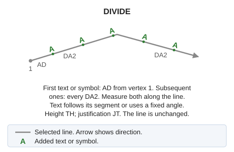
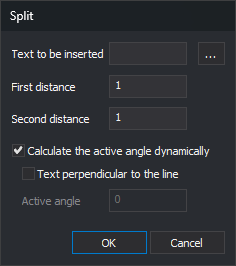

# DIVIDE
<!-- id: dividir -->
<!-- origen: 03ab0a54cd8106ab0bcc3084c9c0eb707a357cef -->

Insert repeated text or symbols along a linear entity.

## Parameters

| Parameter number | Description | Optional |
| :--- | :--- | :--- |
| 1 | Line code | Yes |
| 2 | Text to insert, or symbol as `@<nombre del símbolo>` | Yes |
| 3 | Number: fixed text angle in sexagesimal degrees, with the same origin and direction as the [active angle](/digi3d-ai/referencia/ventana-de-dibujo/variables/a/aa.md). `P`: angle calculated for each segment, with text perpendicular to it. `A`: angle calculated for each segment, with text aligned with it. Letters are case-insensitive | Yes |

`DIVIDE=<código> <texto o símbolo> [ángulo | P | A]`

With parameters 1 and 2, the command processes all undeleted lines in the current drawing file with that code that are visible and inside the area of interest, then ends. Distances are the primary and secondary active distances from [AD](/digi3d-ai/referencia/ventana-de-dibujo/variables/d/da.md). Without parameter 3, text angle is calculated from its containing segment, perpendicular to it, as with `P`.

With only one parameter, the command ends without doing anything.

## Dialog

Without parameters, the **Split** dialog appears:

* **Text to be inserted**: text repeated along the line. For a symbol, enter `@` followed by its name.
* **...**: open **Symbol**, listing code table symbols. Font characters, whose names are numeric, are excluded. Accepting sets **Text to be inserted** to `@<nombre del símbolo>`.
* **First distance**: distance along the line from its first vertex to the first text. Initially the primary active distance.
* **Second distance**: distance between consecutive text entities. Initially the secondary active distance.
* **Calculate the active angle dynamically**: calculate each text angle from its containing segment. Checked each time the dialog opens.
* **Text perpendicular to the line**: available only with **Calculate the active angle dynamically** checked. When checked, each text is perpendicular to its containing segment. Otherwise, it is aligned with the segment and oriented to read left to right, or bottom to top on vertical segments. Digi3D.AI remembers this checkbox between runs.
* **Active angle**: fixed angle of all text in sexagesimal degrees. Initially the [active angle](/digi3d-ai/referencia/ventana-de-dibujo/variables/a/aa.md). Available only with dynamic angle calculation unchecked.

Dialog values apply only to that run and do not change AD or AA. **Text to be inserted** starts empty each time.

Canceling or accepting with empty text ends without inserting anything.

After acceptance, "Select the line to be split" appears. Selecting anything other than a line in the current drawing file plays the error sound and leaves the command waiting for a line.

## Notes

* The first text is placed at the first distance along the line from its first vertex. Subsequent text is placed every second distance until the line ends.
* Distances are horizontal (X and Y), in the same units as AD. Text Z is interpolated from its containing segment.
* Zero or negative distances are replaced by 1. If the second distance is too small to advance the next text position, insertion stops on that line.
* With dynamic angles and perpendicular text, each text is rotated 90° clockwise from the segment direction: its baseline is perpendicular to the line and points right relative to its direction. Aligned text follows the segment direction.
* Text uses [TH](/digi3d-ai/referencia/ventana-de-dibujo/variables/a/at.md) height, [JT](/digi3d-ai/referencia/ventana-de-dibujo/variables/j/jt.md) justification, active codes, and active attributes. The line is unchanged.
* Each run is undone in one step. With parameters, that step includes text from all processed lines.

## Command characteristics

| Command type | [Interactive command](/digi3d-ai/referencia/ventana-de-dibujo/ordenes-interactivas.md) without parameters; immediate command with parameters |
| :--- | :--- |
| Repeats automatically | Yes, when run without parameters |
| Menu option | Edit/Advanced/Insert text repeatedly on a line |
| Toolbar | _This command has no associated toolbar button_ |
| Extension | DigiNG.OrdenesStandard.dll |
| Implementation | Native |
| Related variables | [AA](/digi3d-ai/referencia/ventana-de-dibujo/variables/a/aa.md) — active angle [TH](/digi3d-ai/referencia/ventana-de-dibujo/variables/a/at.md) — text height [AD](/digi3d-ai/referencia/ventana-de-dibujo/variables/d/da.md) — active distance [JT](/digi3d-ai/referencia/ventana-de-dibujo/variables/j/jt.md) — text justification [REPEAT](/digi3d-ai/referencia/ventana-de-dibujo/variables/r/repite.md) — repeat the last command executed |
| Related commands | No related commands |
| Internal name | {550ACFF8-2C01-4f41-8C8F-082658415BC0} |
