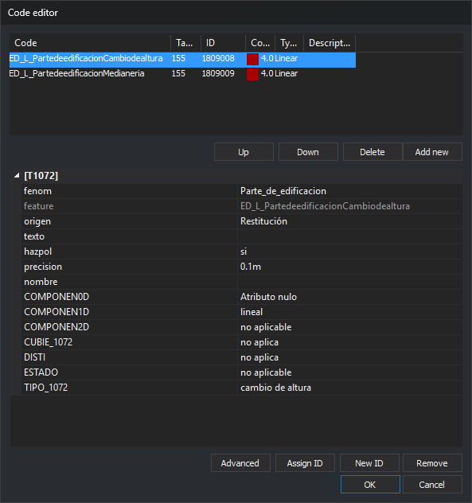
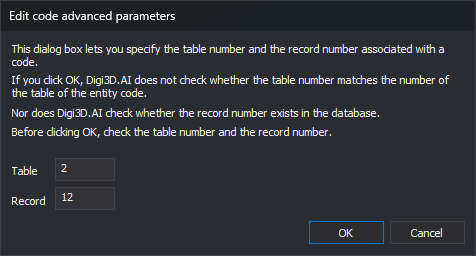
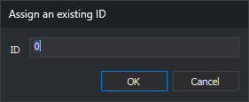

# EDIT\_CODES
<!-- id: editar-cod -->
<!-- origen: c10c428ad81e742e9cbe5aa89dc26afaee052548 -->

Edit the codes of the selected entity.

## Parameters

This command takes no parameters.

## Notes

Select an entity to open the code editing dialog with its codes. On acceptance:

* If codes, their order, their table, or their ID changed, the entity is replaced by a copy with edited codes. The copy also replaces the entity in loaded topologies.
* If only database attributes changed, the same entity is modified.
* Removing all codes deletes the entity.

## Code editor dialog

The dialog shows the selected entity codes.

* **Code list**: each code with database **Table** and **ID**, color, type, and description.
* **Up** and **Down**: reorder the selected code. Enabled only with a code selected.
* **Delete**: remove the selected code. Enabled only with a code selected. **Delete** on the keyboard also removes it.
* **Add new**: open [Select codes](../../../cuadros-de-dialogo/seleccione-codigos.md) to add codes. **Insert** in the list also opens it. Existing codes are not added again unless [Allow repeated codes](../../../cuadros-de-dialogo/configuracion/diging/permitir-codigos-repetidos.md) is enabled.
* **Attributes**: database record fields linked to the selected code. The category title is the table name. Primary keys and fields marked invisible are omitted. Noneditable fields are dimmed.
* **Advanced**: open **Edit code advanced parameters** to change the linked table and record ID. No selection or a nonnumeric code ID does nothing.
* **Assign ID**: open **Assign an existing ID**.
* **New ID**: create a new database record for the selected code on acceptance.
* **Remove**: unlink the selected code from the database and clear its attributes.
* **OK**: apply changes. Create database records for codes without IDs and update records for codes with IDs. A write failure displays the error, but the dialog still closes. If [FORCE\_STORE\_GEOMETRIES\_WITHOUT\_BBDD\_LINK](../../variables/f/forzar-almacenar-geometrias-sin-enlace-bbdd.md) is enabled, **OK** removes table, ID, and attributes from every code and does not write to the database.
* **Cancel**: close without changing the entity.

**Assign ID**, **New ID**, and **Remove** require a selected code associated with a table in the code table. **New ID** is also disabled if the drawing file is not connected to a database.

### Opening after a database storage error

If Digi3D.AI cannot store the attributes of a code in the database, [Error storing data in the database](../../../cuadros-de-dialogo/error-al-almacenar-datos-en-la-base-de-datos.md) appears. **Edit the database attributes.** opens **Code editor** with the failing code. In this mode, **Up**, **Down**, **Delete**, and **Add new** are disabled. Closing **Code editor** retries storing the code.

## Edit code advanced parameters dialog

**Advanced** opens **Edit code advanced parameters** to manually change the database table and record linked to the selected code. It warns that neither the table number for the entity code nor record existence is checked, ending with "Use this box with caution."

* **Table**: database table number, initially the table currently linked to the code.
* **Register**: record number in that table, initially the current code ID.
* **OK**: link to that table and record without checking whether the table matches the code or the record exists.
* **Cancel**: close without changing the link.

## Assign an existing ID dialog

**Assign ID** opens **Assign an existing ID**, linking the selected code to the specified existing database record instead of creating one.

* **ID**: database record identifier to link.
* **OK**: link to that record without checking that it exists.
* **Cancel**: close without changing the link.

If quality control rejects the copy with edited codes, the original entity remains unchanged.

## Command characteristics

| Command type                                    | [Interactive command](/digi3d-ai/referencia/ordenes/ordenes-interactivas.md)                                                                                                                              |
| ------------------------------------------------ | --------------------------------------------------------------------------------------------------------------------------------------------------------------- |
| Repeats automatically                           | Yes |
| Menu option           | Edit/Edit entity codes...                                                                                                                     |
| Toolbar | Edit codes                                                                                                                                                  |
| Extension                                        | DigiNG.OrdenesStandard.dll                                                                                                                                      |
| Implementation | Native |
| Related variables                           | [REPEAT](/digi3d-ai/referencia/ventana-de-dibujo/variables/r/repite.md) — repeat the last command executed [FORCE\_STORE\_GEOMETRIES\_WITHOUT\_BBDD\_LINK](/digi3d-ai/referencia/ventana-de-dibujo/variables/f/forzar-almacenar-geometrias-sin-enlace-bbdd.md) — on acceptance, remove database links from codes |
| Related commands                             | [ADD\_CODES](/digi3d-ai/referencia/ventana-de-dibujo/ordenes/a/anadir-codigos.md) [CHNG\_COD](/digi3d-ai/referencia/ventana-de-dibujo/ordenes/c/camb-cod.md) [EDIT\_ATTRIBUTES](/digi3d-ai/referencia/ventana-de-dibujo/ordenes/e/editar_atributos.md) [REPLACE\_COD](/digi3d-ai/referencia/ventana-de-dibujo/ordenes/s/sustituye-cod.md) |
| Internal name | {973DB18A-7628-4254-9CB7-BABA38426AC4} |
