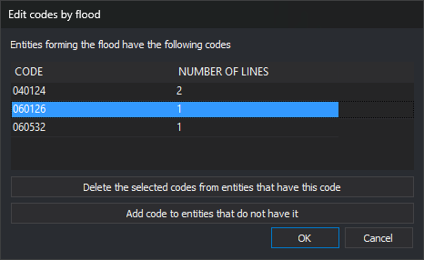

# EDIT\_CODES\_E
<!-- id: editar-codigos-r -->
<!-- origen: f113c6b65086bde96a92e8787d1008b363ab9b57 -->

Add codes to lines forming selected enclosures in the topology for flooding, or remove codes from those lines.

## Parameters

Does not accept parameters.

## Notes

This flooding command works on the topology for flooding, which must first be generated with [GENERATE\_FLOOD\_TOPOLOGY](/digi3d-ai/referencia/ventana-de-dibujo/ordenes/g/generar-topologia-inundacion.md) or [GENERATE\_FLOOD\_TOPOLOGY\_WITHOUT\_ISLANDS](/digi3d-ai/referencia/ventana-de-dibujo/ordenes/g/generar-topologia-inundacion-sin-islas.md). Without it, the menu option is disabled. Typing the command displays "No temporary topology is created", sounds the error tone, and ends.

The topology for flooding is not updated when other commands modify the drawing: it excludes lines drawn after generation, and deleted lines are no longer considered. Regenerate the topology after modifying the drawing. Changes made by this command are reflected in the topology.

### Selecting enclosures

The command displays "Select the area" and highlights the enclosure under the cursor.

* Press the data button inside an enclosure to select it. The previous selection is discarded.
* Hold Ctrl while pressing the data button to add or remove an enclosure from the selection.
* Press the snap button to replace the last selected enclosure with the next unselected enclosure containing the point. If there is none, the last enclosure is removed and the command sounds the error tone.
* Press the reset button to clear the selection.
* Press the spacebar to accept. If no enclosure is selected, the command sounds the error tone.
* Press Esc to end the command.

The command processes lines on the exterior boundaries and holes of selected enclosures. A line shared by two selected enclosures is not processed because it lies inside the selected area.

### Dialog box

Accepting the selection displays _Edit codes by flood_. The list contains codes of the processed lines, in alphabetical order:

| Column | Description |
| :--- | :--- |
| Code | Code name |
| Number of lines | Number of lines with the code. A line with repeated instances of the code is counted once |

* _Delete the selected codes from entities that have this code_: remove codes of selected rows from the list. Enabled only when at least one row is selected.
* _Add code to entities that do not have it_: open the code search dialog box to choose one or more codes. The command does not use the active codes. Each chosen code appears in the list with the total line count. Adding a previously removed code cancels its removal.

The buttons only change the list. Lines are modified when you click _Accept_. Click _Cancel_ to end without changing anything.

The dialog box remembers its size and position.

### Operation

Clicking _Accept_ processes each line:

* Remove every instance of each deleted code.
* Append each added code the line does not already have, without attributes. A line already bearing the code does not receive it again, even if repeated codes are allowed.
* Codes retained by the line keep their attributes.
* Delete the line if it has no codes left.
* Leave the line unchanged if none of its codes changes.

Each modified line is replaced with a new line with the same vertices and resulting codes. The topology for flooding and loaded topologies of the active drawing file use the new line.

[UNDO](/digi3d-ai/referencia/ventana-de-dibujo/ordenes/u/undo.md) undoes all changes from one execution in a single operation.

## Command characteristics

| Command type | [Interactive command](/digi3d-ai/referencia/ventana-de-dibujo/ordenes-interactivas.md) |
| :--- | :--- |
| Repeats automatically | Yes, if [REPEAT](/digi3d-ai/referencia/ventana-de-dibujo/variables/r/repite.md) is enabled. It does not repeat after pressing Esc or when no topology for flooding exists |
| Menu option | Flooding/Edit codes... |
| Toolbar | _This command has no associated toolbar button_ |
| Extension | DigiNG.OrdenesTopologia.dll |
| Implementation | Native |
| Related variables | [REPEAT](/digi3d-ai/referencia/ventana-de-dibujo/variables/r/repite.md) |
| Related commands | [GENERATE\_FLOOD\_TOPOLOGY](/digi3d-ai/referencia/ventana-de-dibujo/ordenes/g/generar-topologia-inundacion.md) [GENERATE\_FLOOD\_TOPOLOGY\_WITHOUT\_ISLANDS](/digi3d-ai/referencia/ventana-de-dibujo/ordenes/g/generar-topologia-inundacion-sin-islas.md) [UNLOAD\_FLOOD\_TOPOLOGY](/digi3d-ai/referencia/ventana-de-dibujo/ordenes/d/descargar-topologia-inundacion.md) [ADD\_ACTIVE\_CODES\_AND\_CENTROID](/digi3d-ai/referencia/ventana-de-dibujo/ordenes/a/anade-codigos-activos-y-centroide.md) [DELETE\_COD\_E](/digi3d-ai/referencia/ventana-de-dibujo/ordenes/b/borra-cod-r.md) [CHNG\_COD\_E](/digi3d-ai/referencia/ventana-de-dibujo/ordenes/c/camb-cod-r.md) [SHOW\_COD\_F](/digi3d-ai/referencia/ventana-de-dibujo/ordenes/m/mostrar-cod-i.md) [PUT\_ATR\_E](/digi3d-ai/referencia/ventana-de-dibujo/ordenes/p/poner-atr-r.md) [PUT\_COD\_ENCLOSURE\_CENTROID](/digi3d-ai/referencia/ventana-de-dibujo/ordenes/p/poner-cod-recinto-centroide.md) [UNDO](/digi3d-ai/referencia/ventana-de-dibujo/ordenes/u/undo.md) |
| Internal name | {13FEE65F-C296-4498-BFD8-41A4E80124A4} |
